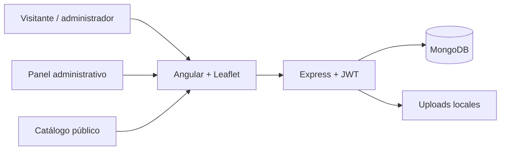

# FalconSync

Plataforma digital para la promoción, gestión y seguimiento del patrimonio turístico de Coro, con mapa interactivo, catálogo de lugares, autenticación de usuarios, check-ins por geolocalización y panel administrativo.

## Visión general

FalconSync reúne dos capas complementarias:

- Frontend moderno en Angular para la experiencia pública y administrativa.
- Backend REST en Node.js + Express + MongoDB para la lógica de negocio, seguridad y persistencia.

El proyecto está orientado a digitalizar la experiencia turística de Falcón y centralizar la información patrimonial en una solución gestionable, escalable y verificable.

## Arquitectura



## Funcionalidades principales

- Catálogo público de lugares y puntos de interés (POI)
- Mapa interactivo con geolocalización y filtro regional
- Autenticación con JWT y cookies de refresco
- Roles de usuario, historiador, inspector y administrador (`moderator` legacy en migración)
- Gestión administrativa de POI, estados y validaciones
- Flujo de conservación: reportes, inspecciones, hallazgos, intervenciones y cierre
- Evidencia privada con hash, autorización por recurso y acceso auditado
- Visitas 360° con visor WebGL propio, hotspots, fallback y curaduría editorial
- Check-in por lugar con QR y geocerca
- Perfil privado con avatar y galería de fotos
- Insignias por visita y métricas de actividad
- Auditoría de cambios y soporte para imágenes locales
- Suite E2E con Playwright para validación continua

## Stack tecnológico

| Componente | Tecnología |
|---|---|
| Frontend | Angular 21 |
| Mapa | Leaflet 1.9.4 |
| Backend | Node.js + Express 5 |
| Base de datos | MongoDB 9 |
| Autenticación | JWT + cookies HttpOnly |
| Seguridad | bcryptjs, rate limiting, helmet |
| Testing | Node test runner + Playwright |
| Build | Angular CLI |

## Estructura del repositorio

La estructura obligatoria está descrita en [`AGENTS.md`](AGENTS.md) y registrada como decisión en [`memory/architecture_decisions.md`](memory/architecture_decisions.md).

```text
FalconSync/
├── AGENTS.md                 # Normas de ejecución y organización
├── context/                  # Contexto del sistema, reglas de negocio (con RBAC) y contratos HTTP
├── memory/                   # Decisiones arquitectónicas y soluciones verificadas
├── skills/                   # Índice de skills locales (las ejecutables están en .opencode/skills/)
├── projects/
│   ├── backend/              # API Express y MongoDB (ver projects/backend/README.md)
│   ├── frontend/             # SPA Angular (ver projects/frontend/README.md)
│   └── mobile/               # Esqueleto de la app de campo; no compilable
├── docs/                     # Documentación técnica y funcional ampliada
├── .github/workflows/        # CI de validación
├── .opencode/                # Agentes, skills y conocimiento de OpenCode
├── README.md                 # Documento principal
├── CONTRIBUTING.md           # Guía de colaboración
└── package.json              # Scripts del repositorio raíz
```

Las excepciones a la estructura (documentación ampliada, herramientas y pruebas) están listadas en `memory/architecture_decisions.md`.

## Requisitos previos

Antes de iniciar el proyecto asegúrate de tener instalado:

- Node.js 26.13.0 o superior
- MongoDB 9.0.4 local o equivalente
- Git
- Un navegador moderno para pruebas locales

## Instalación rápida

### 1. Clonar el repositorio

```bash
git clone https://github.com/Isaacoronam/FalconSync.git
cd FalconSync
```

### 2. Instalar dependencias del backend

```bash
npm install --prefix projects/backend
```

### 3. Instalar dependencias del frontend

```bash
npm install --prefix projects/frontend
```

### 4. Configurar variables de entorno

Crea un archivo `.env` dentro de `projects/backend/` con la estructura del ejemplo:

```env
NODE_ENV=development
PORT=3000
MONGODB_URI=mongodb://127.0.0.1:27017/falconsync
CORS_ORIGIN=http://localhost:4200
TRUST_PROXY=false

JWT_ACCESS_SECRET=tu_secreto_de_acceso
JWT_REFRESH_SECRET=tu_secreto_de_refresco
ACCESS_TOKEN_TTL_SECONDS=900
REFRESH_TOKEN_TTL_DAYS=7
BCRYPT_COST=12
REFRESH_COOKIE_NAME=falconsync_refresh
COOKIE_SECURE=false

UPLOAD_DIR=./uploads/images
UPLOAD_PRIVATE_DIR=./uploads/documents
UPLOAD_MAX_IMAGE_BYTES=5242880

ADMIN_EMAIL=admin@example.com
ADMIN_PASSWORD=cambia-esta-clave
ADMIN_NAME=Administrador FalconSync
```

Puedes usar el archivo base `projects/backend/.env.example` como referencia.

Conservación y evidencia necesitan transacciones. Para trabajar en esos módulos, apunta
`MONGODB_URI` a un replica set de un nodo, por ejemplo
`mongodb://127.0.0.1:27018/falconsync?replicaSet=falconsyncTest`. El standalone de
`127.0.0.1:27017` sigue sirviendo para los módulos que no usan transacciones.

## Ejecución local

### Backend

```bash
npm --prefix projects/backend run dev
```

El backend queda disponible en:

- http://localhost:3000

### Frontend

```bash
npm --prefix projects/frontend run start
```

El frontend queda disponible en:

- http://localhost:4200

## Scripts útiles

Desde la raíz del proyecto puedes ejecutar:

```bash
npm run test:backend
npm run test:frontend
npm run build
npm run e2e
npm run verify
```

El E2E usa por defecto la base `falconsync_e2e` en el replica set local
`mongodb://127.0.0.1:27018` (`replicaSet=falconsyncTest`), porque conservación y
evidencia requieren transacciones. Puedes sobrescribirlo con `E2E_MONGODB_URI`.

El workflow de CI (`.github/workflows/ci.yml`) se ejecuta en push y PR a `develop`, `main` y
`master`, inicia un replica set de MongoDB y reproduce las auditorías, pruebas, build y E2E.
La ejecución remota requiere publicar la rama o el PR; hasta entonces se considera
reproducible en local, no CI remoto verde.

También están disponibles tareas específicas para sembrar datos, publicar POI y generar QR:

```bash
npm run seed:sync
npm run publish:pois
npm run qr:generate
npm run seed:adventures
```

## Documentación del proyecto

La documentación del sistema se encuentra organizada en:

- [docs/PLAN-IMPLEMENTACION.md](docs/PLAN-IMPLEMENTACION.md) — plan ejecutable, fases, criterios y matriz de pruebas
- [docs/MODELO-DATOS.md](docs/MODELO-DATOS.md) — modelo de dominio, ER, estados e invariantes (propuesta de Fase 1)
- [docs/CASOS-USO.md](docs/CASOS-USO.md) — casos de uso, secuencias y errores (propuesta de Fase 1)
- [docs/openapi.yaml](docs/openapi.yaml) — contrato HTTP del dominio planificado, con estado por operación
- [docs/EVENTOS-TIEMPO-REAL.md](docs/EVENTOS-TIEMPO-REAL.md) — Socket.IO, ticket, salas y reconexión (propuesta de Fase 1)
- [docs/WIREFRAMES.md](docs/WIREFRAMES.md) — rutas, pantallas, estados y accesibilidad (propuesta de Fase 1)
- [docs/360.md](docs/360.md) — diseño de la visita 360° (propuesta de Fase 1)
- [docs/REQUISITOS.md](docs/REQUISITOS.md) — SRS, reglas de negocio, historias y trazabilidad
- [docs/RBAC.md](docs/RBAC.md) — roles, capacidades, autorización y migración
- [docs/FUENTES-RAG.md](docs/FUENTES-RAG.md) — fuentes, ingesta, citas y asistentes
- [docs/SEGURIDAD.md](docs/SEGURIDAD.md) — modelo de amenazas y controles
- [docs/OPERACION.md](docs/OPERACION.md) — SLO, RPO/RTO, backups y runbook
- [docs/ADR/README.md](docs/ADR/README.md) — registro de decisiones arquitectónicas
- [docs/FALCONSYNC.md](docs/FALCONSYNC.md) — estado general del proyecto y alcance
- [docs/AUTENTICACION.md](docs/AUTENTICACION.md) — autenticación, sesiones y seguridad
- [docs/ADMINISTRACION.md](docs/ADMINISTRACION.md) — panel administrativo, POI y auditoría
- [docs/POI.md](docs/POI.md) — catálogo, editorial, publicaciones y fuentes
- [docs/AVENTURAS.md](docs/AVENTURAS.md) — compatibilidad heredada y recorridos
- [docs/PERFIL.md](docs/PERFIL.md) — perfil privado, avatar y galería
- [CONTRIBUTING.md](CONTRIBUTING.md) — normas de contribución y flujo de trabajo

## Contribución

Toda contribución debe seguir el flujo de trabajo publicado en [CONTRIBUTING.md](CONTRIBUTING.md). Antes de abrir un pull request, revisa el estándar de ramas, conventional commits y checklist de validación.

## Licencia

Este proyecto se desarrolla con fines de aprendizaje, prototipado y entrega académica.
