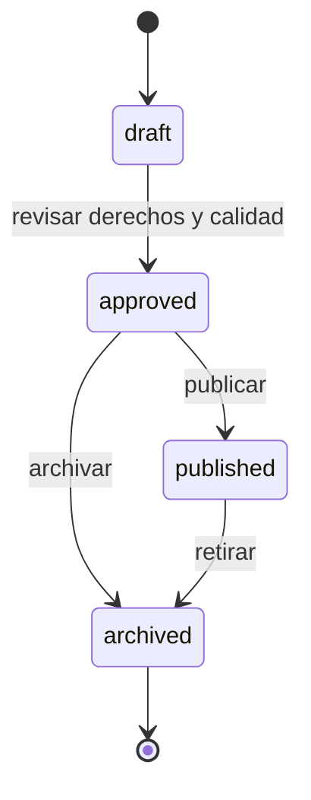

# Visita 360° — diseño técnico y de experiencia

| Campo | Valor |
|---|---|
| Versión | 1.0-draft |
| Fecha | 2026-11-13 |
| Estado | Diseño de Fase 1; **propuesto, no implementado**. Derechos, biblioteca y hosting pendientes. |
| Autoridad | [`PLAN-IMPLEMENTACION.md`](./PLAN-IMPLEMENTACION.md), [`ADR-006`](./ADR/ADR-006-visita-360.md), [`REQUISITOS.md`](./REQUISITOS.md) |
| Documentos relacionados | [`MODELO-DATOS.md`](./MODELO-DATOS.md), [`WIREFRAMES.md`](./WIREFRAMES.md), [`SEGURIDAD.md`](./SEGURIDAD.md), [`OPERACION.md`](./OPERACION.md) |

> La visita 360° es obligatoria, pero **no existe hoy**: no hay modelo, visor, inventario ni
> contenido con derechos verificados. Este documento define el objetivo y las puertas de
> publicación; no declara ninguna panorámica disponible.

## 1. Alcance

Incluye:

- el modelo público de una escena 360° y su enlace con un POI o activo;
- la captura, revisión, aprobación y publicación;
- el visor web con hotspots, teclado, fallback y movimiento reducido;
- la separación entre panoramas turísticos y panoramas de inspección;
- los derechos, créditos, consentimiento y metadatos;
- el rendimiento, almacenamiento y integridad;
- las pruebas de accesibilidad, seguridad y carga.

No incluye:

- captura con dron, fotogrametría o modelado 3D;
- recorridos con transiciones automáticas;
- realidad aumentada;
- audio o multilingüe mientras D-18 no se apruebe;
- publicación de contenido sin licencia.

## 2. Requisitos que gobiernan el diseño

| Requisito | Implicación |
|---|---|
| RF-67 a RF-70 | Visita 360 pública, hotspots, fallback y accesibilidad. |
| ADR-006 | Derechos documentados, separación público/inspección, fallback obligatorio. |
| D-18 | Audio e idiomas condicionales; sin aprobación no se implementa `AudioGuide`. |
| D-23 | Retención de originales y derivados; pendiente. |
| RNF de accesibilidad | WCAG 2.2 AA; teclado, contraste, movimiento reducido. |
| SEGURIDAD | Sin metadatos sensibles, sin acceso público a originales, sin fuga de panoramas internos. |

## 3. Principios

1. **Derechos primero.** Sin autoría, licencia, crédito y consentimiento no hay publicación.
2. **El original es privado.** Se conserva el archivo maestro; se publican derivados
   controlados y con checksum.
3. **Fallback siempre.** Toda escena tiene imagen estática, texto alternativo y descripción;
   si el visor falla, la información sigue siendo accesible.
4. **El panorama no es un diagnóstico.** Un panorama de inspección es evidencia técnica; no
   se presenta como visita turística ni se sirve por la API pública.
5. **Navegación comprensible.** Los hotspots tienen etiqueta, destino y propósito; no son
   puntos sin texto.
6. **Sin sorpresas de movimiento.** No hay autogiro, autoplay ni transiciones que mareen.
7. **Progresivo.** La ficha del POI no depende de WebGL para mostrar su contenido.

## 4. Modelo de contenido

El detalle de campos está en [`MODELO-DATOS.md`](./MODELO-DATOS.md), sección 5.16. Resumen:

```text
Panorama
  ├── assetId? / locationId?     al menos un destino
  ├── title, description
  ├── imageKey, projection, width, height, checksum
  ├── license, licenseUrl, author, credit
  ├── capturedAt
  ├── status: draft | approved | published | archived
  ├── visibility: public | inspection
  ├── hotspots[]
  ├── fallback { imageUrl, alt, description, transcript? }
  ├── consent { peopleBlurred, consentDocumented, notes? }
  └── createdBy / updatedBy / timestamps
```

Reglas:

- `projection` es `equirectangular`; la relación de aspecto es 2:1.
- `visibility=inspection` no se sirve por `/api/panoramas` ni por la ficha pública.
- Un panorama `published` debe tener `approved`, derechos completos y fallback.
- El `checksum` se verifica al publicar y al servir el derivado.
- Los hotspots solo apuntan a panoramas publicados, POI publicados o URLs internas
  permitidas; no a dominios arbitrarios.

### 4.1 Hotspot

| Campo | Tipo | Regla |
|---|---|---|
| `hotspotId` | String UUID | Único dentro del panorama. |
| `label` | String(80) | Texto visible. |
| `type` | Enum `scene`, `location`, `info` | Determina el icono y la acción. |
| `yaw` | Number | Grados; rango `[-180, 180]`. |
| `pitch` | Number | Grados; rango `[-90, 90]`. |
| `targetPanoramaId` | ObjectId \| null | Obligatorio si `type=scene`. |
| `targetLocationId` | ObjectId \| null | Obligatorio si `type=location`. |
| `targetUrl` | String(500) \| null | Solo si `type=info`; URL interna o autorizada. |
| `ariaLabel` | String(120) | Describe la acción, no solo el destino. |

## 5. Derechos, consentimiento y privacidad

### 5.1 Puerta de derechos

Antes de aprobar un panorama se verifica:

- [ ] Autoría identificada o decisión expresa de anonimato.
- [ ] Licencia compatible con publicación web y con el uso turístico.
- [ ] Enlace o documento de la licencia conservado.
- [ ] Crédito visible definido.
- [ ] Permiso del espacio o institución cuando corresponda.
- [ ] Consentimiento para personas identificables.
- [ ] Difuminado aplicado cuando no hay consentimiento.
- [ ] Sin metadatos EXIF sensibles en el derivado público.
- [ ] Sin contenido de inspección, evidencia o zonas restringidas.

Sin esta lista completa, el panorama queda en `draft` o `approved` con publicación bloqueada;
no se publica “temporalmente” ni con un crédito genérico.

### 5.2 Personas y datos

- Las personas identificables se difuminan o se excluyen del encuadre.
- No se publican rostros de menores.
- No se publican matrículas, documentos, interiores privados ni ubicaciones sensibles.
- El original puede conservar más detalle, pero se almacena privado y con acceso restringido.
- El texto alternativo no describe personas identificables sin necesidad.

### 5.3 Separación público / inspección

| Aspecto | Público | Inspección |
|---|---|---|
| Audiencia | Visitante | Inspector, revisor, auditor autorizado |
| API | `/api/panoramas` | No se expone por la API turística |
| Almacenamiento | Derivado público controlado | Original/derivado privado |
| Derechos | Licencia turística | Derechos y consentimiento específicos |
| Metadatos | Créditos y fecha | Puede incluir notas técnicas, nunca datos personales |
| Búsqueda | Indexable | No indexable, `no-store` |

Un panorama de inspección puede enlazarse a una inspección o a un activo, pero no a la
galería pública. La API pública responde `404` si se intenta acceder por ID.

## 6. Arquitectura del visor

### 6.1 Componente Angular

```text
PanoramaViewerComponent (standalone, lazy)
  ├── PanoramaApiService        carga metadatos públicos
  ├── PanoramaRenderer          WebGL/canvas o fallback
  ├── HotspotLayer              posiciona y anuncia hotspots
  ├── FallbackPanel             imagen estática + descripción
  ├── CreditBar                 autoría, licencia, fecha
  └── AccessibilityControls     teclado, movimiento, pantalla completa
```

Reglas:

- El componente no descarga el original; usa el derivado público firmado o servido por API.
- El renderer se carga solo al abrir una escena; la ficha no carga WebGL.
- Si el renderer falla, se muestra el fallback sin romper la página.
- El estado del visor no se guarda en el servidor; la posición es local.
- El componente no acepta HTML arbitrario en etiquetas ni créditos.

### 6.2 Biblioteca de visualización

Criterios de selección:

| Criterio | Peso | Verificación |
|---|---:|---|
| Licencia compatible y aviso conservado | Alto | Revisión legal y de `package.json`. |
| Accesibilidad por teclado y lectores | Alto | Prueba manual y auditoría. |
| Fallback y control de movimiento | Alto | API documentada. |
| Rendimiento en móvil de gama media | Alto | Prueba en dispositivo o emulación. |
| Hotspots con posición y eventos | Medio | API documentada. |
| Mantenimiento y comunidad | Medio | Actividad y issues. |
| Peso del bundle | Medio | Medición del build. |
| Soporte de tiles | Bajo | Solo si el tamaño lo exige. |

Candidatas a evaluar (ninguna adoptada todavía):

| Candidata | Enfoque | Licencia declarada | Nota |
|---|---|---|---|
| Pannellum | Visor 360 ligero | MIT (verificar aviso de la versión) | Hotspots y teclado; evaluar accesibilidad real. |
| Photo Sphere Viewer | Visor 360 con plugins | MIT (verificar aviso de la versión) | Buena API de hotspots; revisar peso. |
| Three.js | Renderer propio | MIT (verificar aviso de la versión) | Máximo control; más código y mantenimiento. |
| A-Frame | WebXR/escenas | MIT (verificar aviso de la versión) | Más pesado; evaluar si no se necesita WebXR. |

**Decisión pendiente:** no se elige biblioteca hasta completar un spike con una escena real,
medir bundle y accesibilidad, y verificar la licencia de la versión exacta. El contrato de
datos no depende de la biblioteca.

### 6.3 Flujo de carga

```text
Usuario abre /panoramas/:id
  → API valida published + visibility=public
  → devuelve metadatos, URL del derivado y fallback
  → SPA muestra fallback de inmediato
  → carga el renderer en segundo plano
  → si WebGL y red lo permiten, sustituye el fallback por la escena
  → si falla, conserva el fallback y muestra un aviso discreto
```

El fallback no es un “modo de error” vergonzante: es parte de la experiencia y debe verse bien.

## 7. Experiencia de uso

### 7.1 Galería

- Tarjetas con miniatura, título, POI y crédito.
- Filtro por POI o circuito.
- Solo panoramas `published` y `visibility=public`.
- Estado vacío: “Aún no hay visitas 360 publicadas para este lugar.”

### 7.2 Visor

| Acción | Ratón/táctil | Teclado | Lector de pantalla |
|---|---|---|---|
| Girar la vista | Arrastrar | Flechas | Se anuncia el cambio de orientación si el usuario lo pide. |
| Zoom | Rueda/pellizco | `+` / `-` | Control etiquetado. |
| Activar hotspot | Clic/tap | Tab + Enter/Espacio | “Ir a Plaza Bolívar, escena”. |
| Pantalla completa | Botón | `F` | Estado anunciado. |
| Movimiento | Botón “Activar movimiento” | Enter | Desactivado por defecto si `prefers-reduced-motion`. |
| Salir | Botón/ESC | Escape | Vuelve al disparador. |

Reglas:

- No hay rotación automática.
- El botón de movimiento es explícito y recuerda la preferencia solo en la sesión.
- Los hotspots se anuncian en orden de lectura, no en orden de coordenadas.
- Si un hotspot apunta a otra escena, se conserva el historial de navegación.
- En móvil, los controles no tapan la escena; se ocultan tras unos segundos sin interacción,
  pero reaparecen con toque o teclado.

### 7.3 Fallback

Debe incluir:

- imagen estática representativa;
- `alt` significativo;
- descripción textual de la escena;
- créditos y licencia;
- enlace a la ficha del POI;
- transcripción si hay audio (D-18).

El fallback se muestra:

- si WebGL no está disponible;
- si la imagen falla o tarda demasiado;
- si el usuario prefiere movimiento reducido y no activa la escena;
- si el dispositivo no cumple el mínimo de rendimiento.

## 8. Rendimiento

| Métrica | Objetivo propuesto | Método |
|---|---|---|
| Peso inicial del visor | ≤ 250 KB gzip (sin imagen) | Build y medición. |
| Imagen equirectangular | ≤ 8 MB para 4096×2048; evaluar tiles si excede | Derivado optimizado. |
| Primer render útil | ≤ 2.5 s en 4G buena | Lighthouse/WebPageTest. |
| Interacción | ≥ 30 fps en móvil de gama media | Prueba en dispositivo. |
| Carga de la ficha sin visor | ≤ 1.5 s p95 | Medición. |

Reglas:

- Formatos: JPEG/WebP para el derivado; AVIF solo si el soporte y la decodificación se
  verifican.
- No se sirve el original de 20–50 MB al navegador.
- Si se usan tiles, el manifiesto y las URLs se generan en el servidor; el cliente no
  adivina rutas.
- Precarga solo la escena actual y, como máximo, la siguiente hotspot.
- `loading="lazy"` para miniaturas de la galería.
- CDN solo para derivados públicos; nunca para evidencia ni panoramas de inspección.

## 9. Almacenamiento, integridad y seguridad

### 9.1 Capas

| Capa | Contenido | Acceso |
|---|---|---|
| Original | Archivo maestro, máxima calidad | Privado; solo administración autorizada. |
| Derivado público | Equirectangular optimizado y miniatura | Público controlado; checksum. |
| Derivado de inspección | Imagen técnica | Privado; autorización por recurso. |

### 9.2 Reglas

- `imageKey` es interno; no se serializa en la API pública.
- El derivado público se sirve por URL firmada de corta duración o por streaming de la API;
  no se expone el bucket como listado.
- El `checksum` SHA-256 se verifica antes de publicar y al menos una vez al servir.
- Se eliminan EXIF/GPS del derivado público; el original conserva lo necesario para
  trazabilidad, con acceso restringido.
- No se aceptan archivos por URL arbitraria ni `Content-Type` declarado por el cliente.
- Se valida la firma binaria y la decodificación de la imagen.
- El panorama de inspección no se indexa, no se cachea en CDN y responde `no-store`.
- Los logs no incluyen la URL firmada completa ni el `imageKey`.

### 9.3 Derechos y retención

- La licencia y el crédito se conservan con el panorama, no solo en la ficha.
- Si se retira una licencia, el panorama pasa a `archived` y deja de servirse.
- La retención del original y del derivado se define en D-23; no se borra nada
  automáticamente hasta aprobarla.
- Un panorama archivado conserva metadatos y checksum para trazabilidad.

## 10. Flujo de carga y publicación



| Paso | Actor | Verificación |
|---|---|---|
| 1. Subir original | Admin con `panorama.manage` | Tipo, tamaño, decodificación, checksum. |
| 2. Completar metadatos | Admin | Título, autoría, licencia, crédito, fecha, destino. |
| 3. Revisar derechos | Admin/legal | Checklist de la sección 5.1. |
| 4. Generar derivados | Sistema | 4096×2048, WebP/JPEG, miniatura, fallback. |
| 5. Revisar escena | Admin | Hotspots, navegación, créditos, fallback. |
| 6. Aprobar | Admin | Estado `approved`. |
| 7. Publicar | Admin | `published` + `visibility` correcta. |
| 8. Verificar | Público/QA | Carga, teclado, móvil, enlaces. |

La publicación no es automática por subir un archivo. Un panorama sin derechos queda en
`draft` y la UI explica qué falta.

## 11. Accesibilidad

- **Objetivo:** WCAG 2.2 AA; se verifica en la implementación, no se declara por diseño.
- El visor tiene una alternativa textual completa antes de cargar WebGL.
- Los controles tienen nombre accesible y estado (`aria-pressed`, `aria-expanded` cuando
  corresponda).
- Los hotspots son botones o enlaces reales, no `div` con `onclick`.
- El foco se mueve al panel de fallback si la escena no carga.
- El orden de tabulación no depende de la posición 3D.
- Se respeta `prefers-reduced-motion`; no hay movimiento automático.
- El zoom no impide el zoom del navegador; no se usa `user-scalable=no`.
- Los créditos y la licencia son legibles y enlazables.
- Si hay audio: transcripción, subtítulos, control de volumen y sin autoplay.
- Se prueba con teclado, lector de pantalla y zoom al 200 %.

## 12. Pruebas

| Prueba | Tipo | Criterio |
|---|---|---|
| Panorama no publicado | Integración | `404` en API pública. |
| Panorama de inspección | Seguridad | `404` en API pública; solo acceso autorizado. |
| Derechos incompletos | Integración | No se publica; error explicable. |
| Checksum alterado | Integridad | No se sirve; alerta. |
| Imagen corrupta | Integración | `422`; no se crea derivado. |
| Fallback sin WebGL | E2E | Se muestra imagen, texto y créditos. |
| Teclado | E2E/accesibilidad | Tab y Enter activan hotspots; Escape cierra. |
| Movimiento reducido | E2E | No hay autogiro; el botón es explícito. |
| Móvil | E2E | Controles accesibles; sin desbordamiento. |
| Carga | Rendimiento | Dentro del presupuesto o reporte de desviación. |
| Hotspot a escena no publicada | Integración | Se rechaza al guardar. |
| URL externa no permitida | Seguridad | Se rechaza. |
| EXIF en derivado | Seguridad | No hay GPS ni metadatos sensibles. |
| Personas sin consentimiento | Revisión | Se difumina o no se publica. |
| Retirada de licencia | Integración | Pasa a `archived`; deja de servirse. |

## 13. Trazabilidad

| Elemento | Requisito |
|---|---|
| `Panorama` y estados | RF-67, RF-68, ADR-006 |
| Derechos y créditos | RF-69, SEGURIDAD |
| Hotspots y navegación | RF-68, RNF accesibilidad |
| Fallback | RF-70 |
| Separación público/inspección | ADR-006, SEGURIDAD |
| `AudioGuide` | D-18, RF-71, RF-72 |
| Retención | D-23 |

## 14. Decisiones pendientes

| ID | Decisión | Estado |
|---|---|---|
| D-18 | Audio e idiomas: alcance, idiomas, licencias y transcripción. | Pendiente |
| D-23 | Retención de originales, derivados y evidencias. | Pendiente |
| — | Biblioteca de visualización y versión exacta. | Pendiente de spike |
| — | Hosting/CDN de derivados públicos y URL firmada. | Pendiente de D-19/D-20 |
| — | Derechos de las panorámicas reales y consentimiento. | Pendiente de contenido |
| — | Presupuesto de peso y tiles para móvil. | Pendiente de medición |
| — | Autoridad que aprueba el contenido 360. | Pendiente |

## 15. Criterios de aceptación de la fase 360

- [ ] Existe al menos una escena con derechos documentados y aprobada.
- [ ] El visor funciona con teclado, fallback y movimiento reducido.
- [ ] La API pública solo devuelve `published` + `visibility=public`.
- [ ] Los panoramas de inspección no aparecen en la API turística.
- [ ] El checksum se verifica y el derivado no contiene EXIF sensible.
- [ ] La ficha del POI sigue siendo usable sin WebGL.
- [ ] La carga cumple el presupuesto o se documenta la desviación.
- [ ] La revisión de accesibilidad se ejecutó con evidencia.
- [ ] No se declara audio ni multilingüe sin D-18 aprobada.
