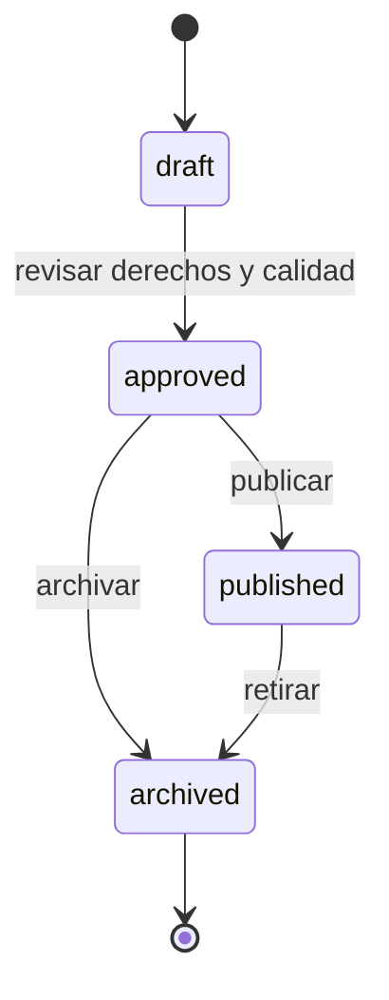

# Visita 360° — diseño técnico y de experiencia

| Campo | Valor |
|---|---|
| Versión | 1.1-implementada |
| Fecha | 2026-11-19 |
| Estado | Backend, API y SPA implementados y probados; **sin panorámicas reales con derechos verificados**. La galería pública queda vacía hasta disponer de contenido. |
| Autoridad | [`PLAN-IMPLEMENTACION.md`](./PLAN-IMPLEMENTACION.md), [`ADR-006`](./ADR/ADR-006-visita-360.md), [`REQUISITOS.md`](./REQUISITOS.md) |
| Documentos relacionados | [`MODELO-DATOS.md`](./MODELO-DATOS.md), [`WIREFRAMES.md`](./WIREFRAMES.md), [`SEGURIDAD.md`](./SEGURIDAD.md), [`OPERACION.md`](./OPERACION.md) |

> La infraestructura 360° existe: modelo `Panorama`, original privado, derivados con `sharp`,
> API pública y administrativa, visor WebGL propio con fallback y flujo editorial separado.
> **No se declara ninguna panorámica disponible**: no hay imágenes reales con derechos
> verificados y no se publicará contenido sintético.

## 1. Alcance

Incluye:

- el modelo público de una escena 360° y su enlace con un POI o activo;
- la captura, revisión, aprobación y publicación;
- el visor web con hotspots, teclado, fallback y movimiento reducido;
- la separación entre panoramas turísticos y panoramas de inspección;
- los derechos, créditos, consentimiento y metadatos;
- el rendimiento, almacenamiento y integridad;
- las pruebas de accesibilidad, seguridad y carga.

No incluye:

- captura con dron, fotogrametría o modelado 3D;
- recorridos con transiciones automáticas;
- realidad aumentada;
- audio o multilingüe mientras D-18 no se apruebe;
- publicación de contenido sin licencia.

## 2. Requisitos que gobiernan el diseño

| Requisito | Implicación |
|---|---|
| RF-67 a RF-70 | Visita 360 pública, hotspots, fallback y accesibilidad. |
| ADR-006 | Derechos documentados, separación público/inspección, fallback obligatorio. |
| D-18 | Audio e idiomas condicionales; sin aprobación no se implementa `AudioGuide`. |
| D-23 | Retención de originales y derivados; pendiente. |
| RNF de accesibilidad | WCAG 2.2 AA; teclado, contraste, movimiento reducido. |
| SEGURIDAD | Sin metadatos sensibles, sin acceso público a originales, sin fuga de panoramas internos. |

## 3. Principios

1. **Derechos primero.** Sin autoría, licencia, crédito y consentimiento no hay publicación.
2. **El original es privado.** Se conserva el archivo maestro; se publican derivados
   controlados y con checksum.
3. **Fallback siempre.** Toda escena tiene imagen estática, texto alternativo y descripción;
   si el visor falla, la información sigue siendo accesible.
4. **El panorama no es un diagnóstico.** Un panorama de inspección es evidencia técnica; no
   se presenta como visita turística ni se sirve por la API pública.
5. **Navegación comprensible.** Los hotspots tienen etiqueta, destino y propósito; no son
   puntos sin texto.
6. **Sin sorpresas de movimiento.** No hay autogiro, autoplay ni transiciones que mareen.
7. **Progresivo.** La ficha del POI no depende de WebGL para mostrar su contenido.

## 4. Modelo de contenido

El detalle de campos está en [`MODELO-DATOS.md`](./MODELO-DATOS.md), sección 5.16. Resumen:

```text
Panorama
  ├── assetId? / locationId?     al menos un destino
  ├── title, description
  ├── imageKey, derivativeKey, thumbnailKey
  ├── projection, width, height, bytes
  ├── checksum, derivativeChecksum, thumbnailChecksum
  ├── license, licenseUrl, author, credit
  ├── capturedAt
  ├── status: draft | approved | published | archived
  ├── visibility: public | inspection
  ├── rightsDocumented, permitDocumented, rightsNotes?
  ├── hotspots[]
  ├── fallback { alt, description, transcript? }
  ├── consent { peopleBlurred, consentDocumented, notes? }
  ├── approvedAt/By, publishedAt/By, archivedAt
  ├── createdBy / updatedBy / version / timestamps
  └── imageUrl y thumbnailUrl se derivan al serializar; las claves nunca salen
```

Reglas:

- `projection` es `equirectangular`; la relación de aspecto es 2:1.
- `visibility=inspection` no se sirve por `/api/panoramas` ni por la ficha pública.
- Un panorama `published` debe tener `approved`, derechos completos y fallback.
- El `checksum` se verifica al publicar y al servir el derivado.
- Los hotspots solo apuntan a panoramas publicados, POI publicados o URLs internas
  permitidas; no a dominios arbitrarios.

### 4.1 Hotspot

| Campo | Tipo | Regla |
|---|---|---|
| `hotspotId` | String UUID | Único dentro del panorama. |
| `label` | String(80) | Texto visible. |
| `type` | Enum `scene`, `location`, `info` | Determina el icono y la acción. |
| `yaw` | Number | Grados; rango `[-180, 180]`. |
| `pitch` | Number | Grados; rango `[-90, 90]`. |
| `targetPanoramaId` | ObjectId \| null | Obligatorio si `type=scene`. |
| `targetLocationId` | ObjectId \| null | Obligatorio si `type=location`. |
| `targetUrl` | String(500) \| null | Solo si `type=info`; URL interna o autorizada. |
| `ariaLabel` | String(120) | Describe la acción, no solo el destino. |

## 5. Derechos, consentimiento y privacidad

### 5.1 Puerta de derechos

Antes de aprobar un panorama se verifica:

- [ ] Autoría identificada o decisión expresa de anonimato.
- [ ] Licencia compatible con publicación web y con el uso turístico.
- [ ] Enlace o documento de la licencia conservado.
- [ ] Crédito visible definido.
- [ ] Permiso del espacio o institución cuando corresponda.
- [ ] Consentimiento para personas identificables.
- [ ] Difuminado aplicado cuando no hay consentimiento.
- [ ] Sin metadatos EXIF sensibles en el derivado público.
- [ ] Sin contenido de inspección, evidencia o zonas restringidas.

Sin esta lista completa, el panorama queda en `draft` o `approved` con publicación bloqueada;
no se publica “temporalmente” ni con un crédito genérico.

### 5.2 Personas y datos

- Las personas identificables se difuminan o se excluyen del encuadre.
- No se publican rostros de menores.
- No se publican matrículas, documentos, interiores privados ni ubicaciones sensibles.
- El original puede conservar más detalle, pero se almacena privado y con acceso restringido.
- El texto alternativo no describe personas identificables sin necesidad.

### 5.3 Separación público / inspección

| Aspecto | Público | Inspección |
|---|---|---|
| Audiencia | Visitante | Inspector, revisor, auditor autorizado |
| API | `/api/panoramas` | `/api/admin/panoramas`, solo con `panorama.manage` o `panorama.publish` y destino visible |
| Almacenamiento | Derivado controlado servido por streaming | Original/derivado privado, nunca estático |
| Derechos | Licencia turística | Derechos y consentimiento específicos |
| Metadatos | Créditos y fecha | Puede incluir notas técnicas, nunca datos personales |
| Búsqueda | Indexable | No indexable, `no-store` |

Un panorama de inspección puede enlazarse a una inspección o a un activo, pero no a la
galería pública. La API pública responde `404` si se intenta acceder por ID. El historiador
tampoco ve panoramas de inspección en su bandeja de curaduría: la administración los gestiona
por completo.

## 6. Arquitectura del visor

### 6.1 Componente Angular

```text
PanoramaViewerComponent (standalone, carga diferida con la página)
  ├── PanoramaApiService        metadatos y descarga autenticada de blobs
  ├── PanoramaRenderer          WebGL 1 propio, shader equirectangular
  ├── HotspotLayer              proyección y botones accesibles
  ├── FallbackPanel             imagen fija, alt, descripción y transcripción
  ├── CreditBar                 autoría, licencia, fecha
  └── Controles                 teclado, zoom, centrar y volver a imagen fija
```

Reglas:

- El componente no descarga el original; usa el derivado público o administrativo.
- El renderer se crea solo cuando la persona activa la vista 360°; la ficha no inicializa
  WebGL ni descarga la imagen equirectangular completa.
- Si el renderer falla, se conserva el fallback sin romper la página.
- El estado del visor no se guarda en el servidor; la posición es local.
- El componente no acepta HTML arbitrario en etiquetas ni créditos.
- En administración, la imagen y la miniatura se solicitan con `Authorization: Bearer` y se
  convierten en `blob:` locales; nunca se usa una URL administrativa directa en un ``.

### 6.2 Renderer propio

Se adoptó un **renderer WebGL 1 propio** (`panorama-renderer.ts`), sin biblioteca externa. La
decisión evita añadir dependencias, mantiene el control del contrato de datos y permite un
fallback estricto antes de inicializar el contexto gráfico.

| Aspecto | Implementación |
|---|---|
| Proyección | Equirectangular en un shader de fragmento; sin mallas ni tiles. |
| Entrada | Imagen 2:1 decodificada en el navegador; derivado público o blob autenticado. |
| Cámara | Yaw, pitch y FOV con límites; arrastre, rueda y flechas. |
| Hotspots | Proyección matemática a pantalla con oclusión tras la cámara. |
| Activación | Explícita, mediante botón; nunca automática. |
| Fallback | Imagen fija, texto alternativo, descripción y lista de enlaces. |
| Movimiento | Sin autogiro ni reproducción automática. |

Candidatas descartadas para esta fase: Pannellum, Photo Sphere Viewer, Three.js y A-Frame.
No se descartan para una fase futura si el contenido real exige tiles, WebXR o herramientas
de authoring; cualquier adopción requeriría revisar licencia, peso y accesibilidad.

### 6.3 Flujo de carga

```text
Usuario abre /panoramas/:id
  → API valida published + visibility=public
  → devuelve metadatos, URL del derivado y fallback
  → SPA muestra el fallback de inmediato
  → la persona pulsa «Activar vista 360°»
  → se descarga la imagen, se crea el renderer y se sustituye el fallback
  → si WebGL o la red fallan, se conserva el fallback y se muestra un aviso discreto
```

El fallback no es un “modo de error” vergonzante: es parte de la experiencia y debe verse bien.

## 7. Experiencia de uso

### 7.1 Galería

- Tarjetas con miniatura, título, POI, fecha y crédito.
- La v1 no incluye filtros propios: la ficha del POI consulta `/api/panoramas?locationId=...`.
- Solo panoramas `published` y `visibility=public`.
- Estado vacío: explica que no se publica material sin derechos verificados.

### 7.2 Visor

| Acción | Ratón/táctil | Teclado | Lector de pantalla |
|---|---|---|---|
| Activar la escena | Botón «Activar vista 360°» | Tab + Enter | Se anuncia la carga y el resultado. |
| Girar la vista | Arrastrar | Flechas | Se anuncia el estado del visor. |
| Zoom | Rueda | `+` / `-` | Botones etiquetados. |
| Centrar | Botón «Centrar» | `Inicio` o `0` | Botón etiquetado. |
| Activar hotspot | Clic/tap | Enlaces de la lista «Puntos interactivos» | “Ir a Plaza Bolívar, escena”. |
| Volver a imagen fija | Botón «Ver imagen fija» | Tab + Enter | Se restaura el fallback. |

Reglas:

- No hay rotación automática, autogiro, pantalla completa ni reproducción automática.
- La escena interactiva se activa de forma explícita; el fallback es el estado inicial.
- Los hotspots en el lienzo son ayudas visuales (`aria-hidden`); la navegación accesible se
  ofrece como lista de enlaces reales fuera del lienzo.
- Si un hotspot apunta a otra escena, se navega a `/panoramas/:id` y el historial conserva el
  recorrido.
- En móvil, los controles se agrupan en la parte inferior y no dependen del hover.

### 7.3 Fallback

Debe incluir:

- imagen estática representativa;
- `alt` significativo;
- descripción textual de la escena;
- créditos y licencia;
- enlace a la ficha del POI;
- transcripción si hay audio (D-18).

El fallback se muestra:

- si WebGL no está disponible;
- si la imagen falla o tarda demasiado;
- si el usuario prefiere movimiento reducido y no activa la escena;
- si el dispositivo no cumple el mínimo de rendimiento.

## 8. Rendimiento

| Métrica | Objetivo propuesto | Método |
|---|---|---|
| Peso inicial del visor | ≤ 250 KB gzip (sin imagen) | Build y medición. |
| Imagen equirectangular | ≤ 8 MB para 4096×2048; evaluar tiles si excede | Derivado optimizado. |
| Primer render útil | ≤ 2.5 s en 4G buena | Lighthouse/WebPageTest. |
| Interacción | ≥ 30 fps en móvil de gama media | Prueba en dispositivo. |
| Carga de la ficha sin visor | ≤ 1.5 s p95 | Medición. |

Reglas:

- Formatos: JPEG/WebP para el derivado; AVIF solo si el soporte y la decodificación se
  verifican.
- No se sirve el original de 20–50 MB al navegador.
- Si se usan tiles, el manifiesto y las URLs se generan en el servidor; el cliente no
  adivina rutas.
- Precarga solo la escena actual y, como máximo, la siguiente hotspot.
- `loading="lazy"` para miniaturas de la galería.
- CDN solo para derivados públicos; nunca para evidencia ni panoramas de inspección.

## 9. Almacenamiento, integridad y seguridad

### 9.1 Capas

| Capa | Contenido | Acceso |
|---|---|---|
| Original | Archivo maestro, máxima calidad | Privado; solo administración autorizada. |
| Derivado público | Equirectangular optimizado y miniatura | Público controlado; checksum. |
| Derivado de inspección | Imagen técnica | Privado; autorización por recurso. |

### 9.2 Reglas

- `imageKey` es interno; no se serializa en la API.
- El derivado público se sirve hoy por streaming de la API con verificación de checksum;
  una URL firmada o CDN queda pendiente de D-19/D-20 y no se expone el bucket como listado.
- El `checksum` SHA-256 se verifica antes de publicar y al servir el derivado.
- El original se normaliza con `sharp` y se guarda sin EXIF; el derivado y la miniatura se
  generan desde ese original privado y tampoco conservan metadatos sensibles.
- No se aceptan archivos por URL arbitraria ni `Content-Type` declarado por el cliente.
- Se valida la firma binaria y la decodificación de la imagen.
- El panorama de inspección no se indexa, no se cachea en CDN y responde `no-store`.
- Los logs no incluyen la URL de la imagen ni `imageKey`.

### 9.3 Derechos y retención

- La licencia y el crédito se conservan con el panorama, no solo en la ficha.
- Si se retira una licencia, el panorama pasa a `archived` y deja de servirse.
- La retención del original y del derivado se define en D-23; no se borra nada
  automáticamente hasta aprobarla.
- Un panorama archivado conserva metadatos y checksum para trazabilidad.

## 10. Flujo de carga y publicación



| Paso | Actor | Verificación |
|---|---|---|
| 1. Subir original | Admin con `panorama.manage` | Tipo, tamaño, decodificación, relación 2:1, checksum. |
| 2. Completar metadatos | Admin | Título, autoría, licencia, crédito, fecha, destino. |
| 3. Documentar derechos | Admin | Checklist de la sección 5.1; el historiador lo revisa al curar. |
| 4. Generar derivados | Sistema (`sharp`) | Derivado 4096×2048 y miniatura 640×320, sin EXIF. |
| 5. Revisar escena | Admin | Hotspots, navegación, créditos, fallback. |
| 6. Aprobar | Historiador con `panorama.publish` | Estado `approved`; solo panoramas turísticos. |
| 7. Publicar | Historiador con `panorama.publish` | `published` + `visibility=public`. |
| 8. Verificar | Público/QA | Carga, teclado, móvil, enlaces. |

La publicación no es automática por subir un archivo. Un panorama sin derechos queda en
`draft` y la UI explica qué falta. La administración no puede aprobar ni publicar panoramas
turísticos (`403`), y el historiador no puede crear, editar ni gestionar panoramas de
inspección. Para los de inspección, la administración ejecuta las transiciones con
`panorama.manage`; el historiador no los ve.

La API administrativa expone `GET/POST /api/admin/panoramas`, `GET/PATCH /api/admin/panoramas/:id`,
`POST /api/admin/panoramas/:id/{approve,publish,archive}`, más `image` y `thumbnail` con
autenticación. La API pública expone `GET /api/panoramas`, `GET /api/panoramas/:id`, `image` y
`thumbnail`; todas las consultas públicas exigen `published + visibility=public`.

## 11. Accesibilidad

- **Objetivo:** WCAG 2.2 AA; se verifica en la implementación, no se declara por diseño.
- El visor tiene una alternativa textual completa antes de cargar WebGL.
- Los controles tienen nombre accesible y estado (`aria-pressed`, `aria-expanded` cuando
  corresponda).
- Los hotspots son botones o enlaces reales, no `div` con `onclick`.
- El foco se mueve al panel de fallback si la escena no carga.
- El orden de tabulación no depende de la posición 3D.
- Se respeta `prefers-reduced-motion`; no hay movimiento automático.
- El zoom no impide el zoom del navegador; no se usa `user-scalable=no`.
- Los créditos y la licencia son legibles y enlazables.
- Si hay audio: transcripción, subtítulos, control de volumen y sin autoplay.
- Se prueba con teclado, lector de pantalla y zoom al 200 %.

## 12. Pruebas

| Prueba | Tipo | Criterio | Estado |
|---|---|---|---|
| Panorama no publicado | Integración | `404` en API pública. | Verificado en `test/panorama.test.js`. |
| Panorama de inspección | Seguridad | `404` en API pública; solo acceso autorizado. | Verificado en backend y E2E. |
| Derechos incompletos | Integración | No se publica; error explicable. | Verificado. |
| Separación de capacidades | Seguridad | Admin no aprueba públicos; historiador no gestiona inspección. | Verificado (`403`/`404`). |
| Checksum alterado | Integridad | No se sirve; alerta. | Verificado. |
| Imagen corrupta o no 2:1 | Integración | `422`; no se crea derivado. | Verificado. |
| EXIF/GPS | Seguridad | El original y el derivado no conservan metadatos sensibles. | Verificado con `sharp`. |
| Hotspot a escena no publicada | Integración | Se rechaza al guardar. | Verificado. |
| URL externa no permitida | Seguridad | Se rechaza. | Verificado. |
| Fallback sin WebGL | E2E | Se muestra imagen, texto y créditos. | Verificado en `panoramas.spec.ts`. |
| Activación y vuelta a fallback | E2E | Botón explícito, controles y retorno a imagen fija. | Verificado si el navegador E2E expone WebGL; si no, se comprueba el aviso. |
| Teclado | E2E/accesibilidad | Flechas y controles del visor; enlaces de hotspots. | Verificado parcialmente; falta auditoría manual con lector de pantalla. |
| Móvil | E2E | Controles accesibles; sin desbordamiento. | Pendiente de prueba en dispositivo. |
| Carga | Rendimiento | Dentro del presupuesto o reporte de desviación. | Pendiente de medición. |
| Personas sin consentimiento | Revisión | Se difumina o no se publica. | Regla de modelo implementada; revisión humana pendiente. |
| Retirada de licencia | Integración | Pasa a `archived`; deja de servirse. | Verificado. |

## 13. Trazabilidad

| Elemento | Requisito |
|---|---|
| `Panorama` y estados | RF-67, RF-68, ADR-006 |
| Derechos y créditos | RF-69, SEGURIDAD |
| Hotspots y navegación | RF-68, RNF accesibilidad |
| Fallback | RF-70 |
| Separación público/inspección | ADR-006, SEGURIDAD |
| `AudioGuide` | D-18, RF-71, RF-72 |
| Retención | D-23 |

## 14. Decisiones pendientes

| ID | Decisión | Estado |
|---|---|---|
| D-18 | Audio e idiomas: alcance, idiomas, licencias y transcripción. | Pendiente |
| D-23 | Retención de originales, derivados y evidencias. | Pendiente |
| — | Renderer WebGL 1 propio, sin biblioteca externa. | Decidido e implementado |
| — | Separación editorial: administración configura; historiador aprueba y publica. | Decidido e implementado |
| — | Hosting/CDN de derivados públicos y URL firmada. | Pendiente de D-19/D-20; hoy se sirve por streaming de la API |
| — | Derechos de las panorámicas reales y consentimiento. | Pendiente de contenido |
| — | Presupuesto de peso y tiles para móvil. | Pendiente de medición con imágenes reales |

## 15. Criterios de aceptación de la fase 360

- [ ] Existe al menos una escena con derechos documentados y aprobada. _(Pendiente de contenido real.)_
- [x] El visor funciona con teclado, fallback y sin movimiento automático.
- [x] La API pública solo devuelve `published` + `visibility=public`.
- [x] Los panoramas de inspección no aparecen en la API turística.
- [x] El checksum se verifica y los derivados no contienen EXIF sensible.
- [x] La ficha del POI sigue siendo usable sin WebGL.
- [ ] La carga cumple el presupuesto o se documenta la desviación. _(Pendiente de medición.)_
- [ ] La revisión de accesibilidad se ejecutó con evidencia manual. _(Pendiente de auditoría.)_
- [x] No se declara audio ni multilingüe sin D-18 aprobada.
