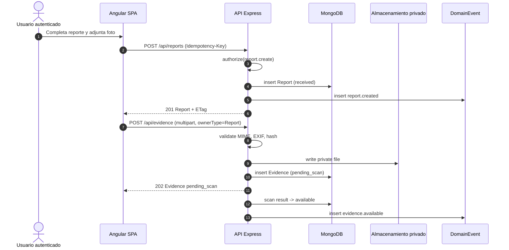
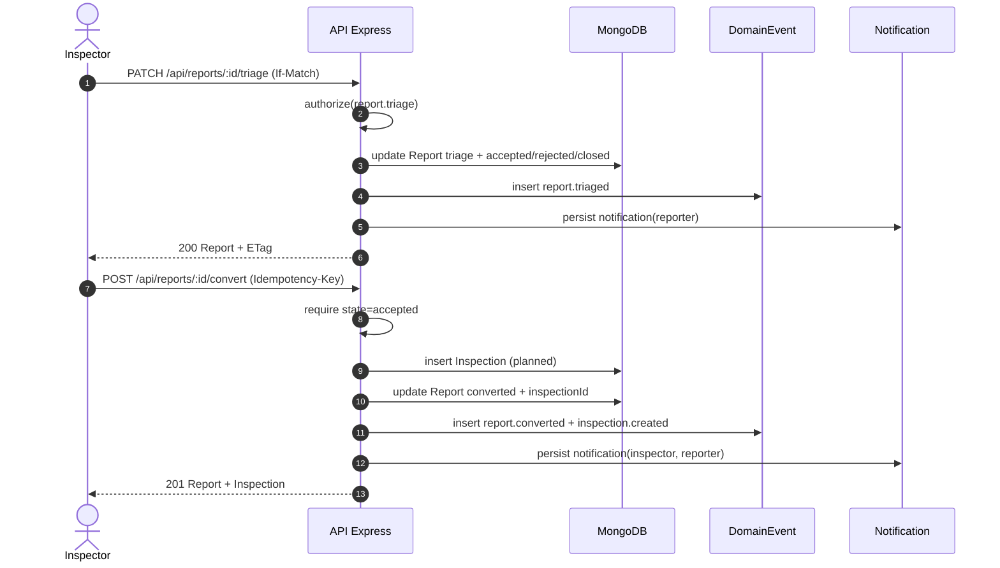
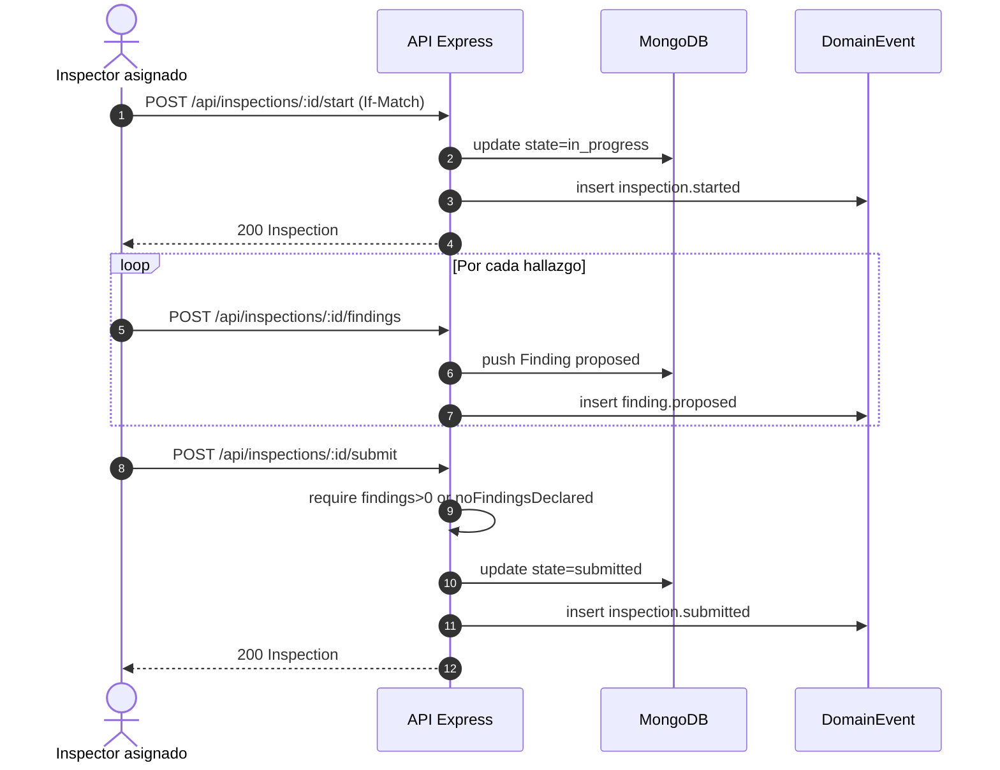
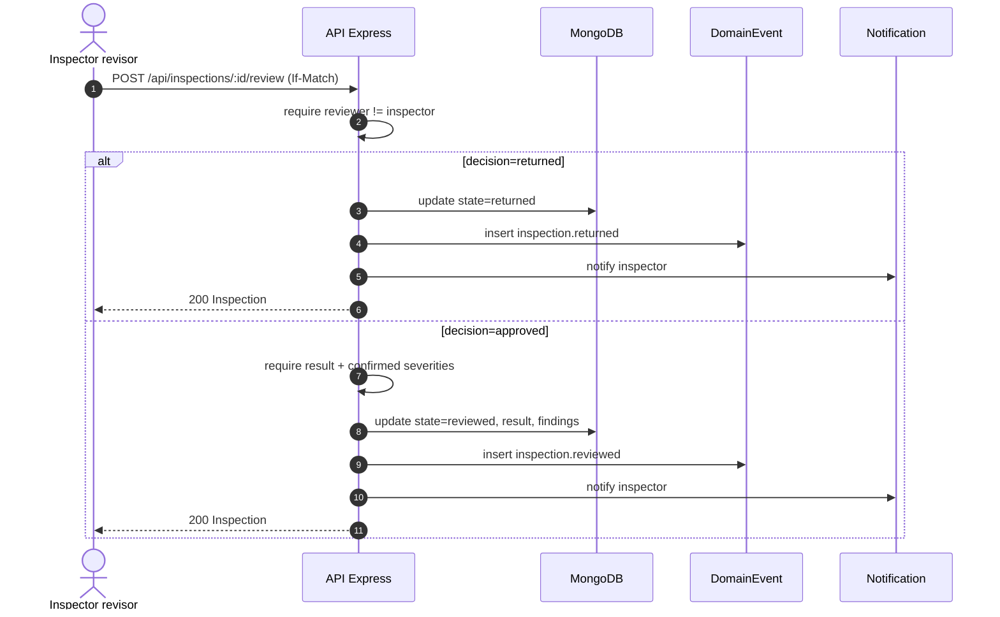
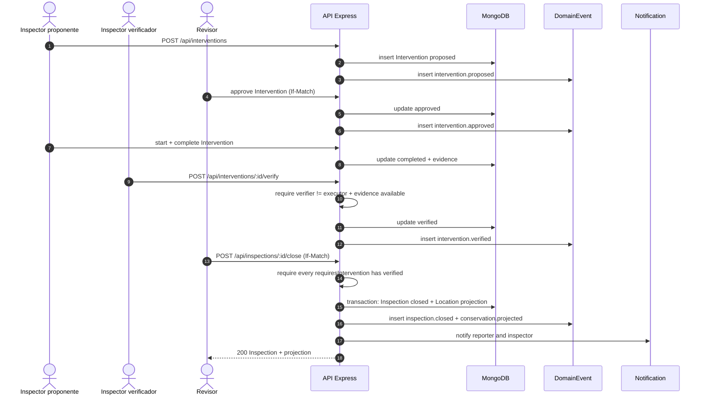
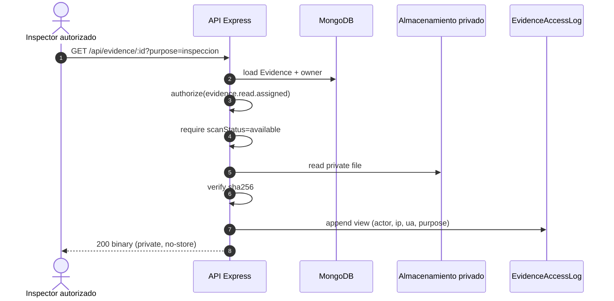
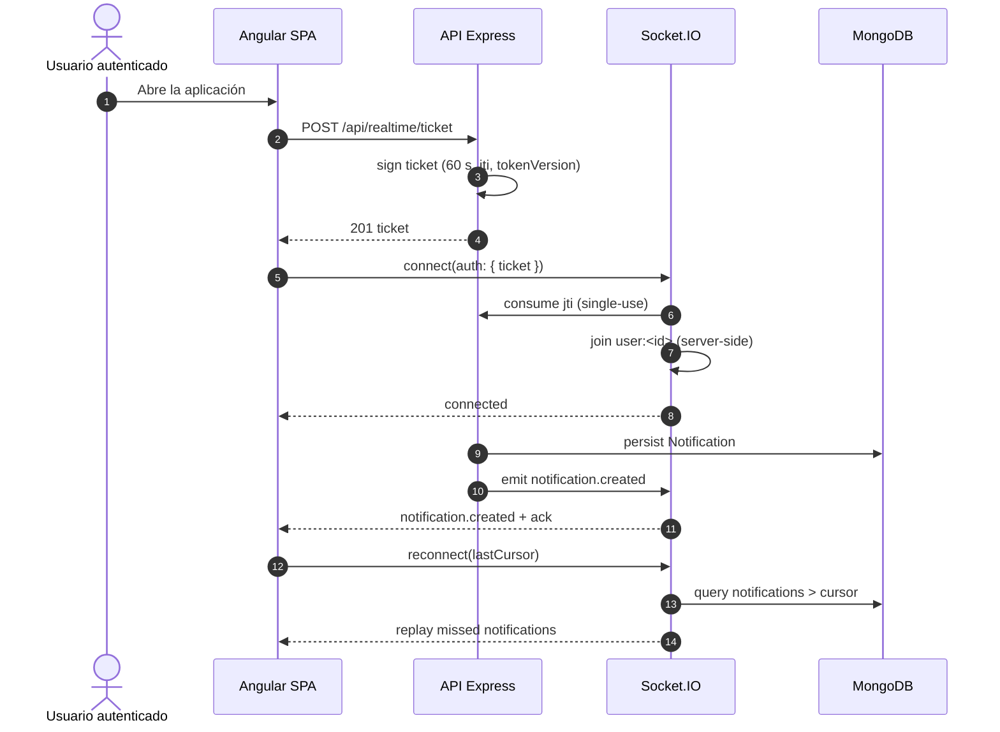
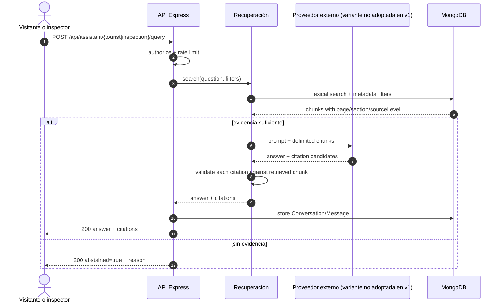
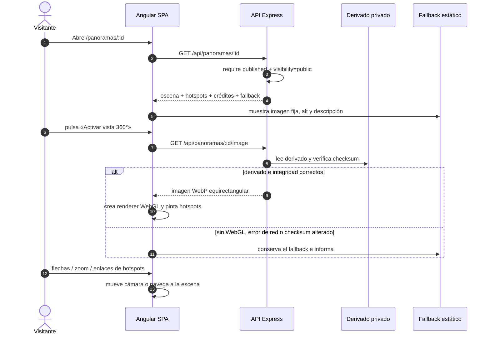
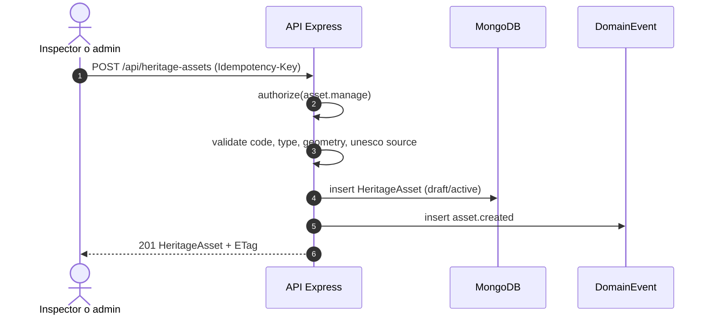

# Casos de uso y secuencias — FALCONSYNC

| Campo | Valor |
|---|---|
| Versión | 1.0-draft |
| Fecha | 2026-11-13 |
| Estado | Diseño de Fase 1; **propuesto, no implementado**. Requiere aprobación del contrato. |
| Autoridad | [`PLAN-IMPLEMENTACION.md`](./PLAN-IMPLEMENTACION.md), [`REQUISITOS.md`](./REQUISITOS.md), [`RBAC.md`](./RBAC.md), [`MODELO-DATOS.md`](./MODELO-DATOS.md) |
| Documentos relacionados | [`openapi.yaml`](./openapi.yaml), [`EVENTOS-TIEMPO-REAL.md`](./EVENTOS-TIEMPO-REAL.md), [`WIREFRAMES.md`](./WIREFRAMES.md), [`360.md`](./360.md) |

> Los casos describen el comportamiento objetivo. No sustituyen las pruebas ni declaran
> endpoints implementados. Las capacidades se aplican en el servidor; los guards de Angular
> solo mejoran la experiencia.

## 1. Actores y capacidades

| Actor | Rol de sistema | Capacidades principales |
|---|---|---|
| Visitante | Sin sesión | `assistant.tourist` con rate limit; lectura pública; 360 publicado. |
| Turista | `user` | `report.create`, `report.read.own`, `evidence.upload` a su reporte, `notification.read.own`, `realtime.connect`. |
| Historiador | `historian` | `content.edit`, `content.review`, `source.read`, consulta del asistente técnico; no confirma severidad ni cierra inspecciones. |
| Inspector | `inspector` | `report.read.all`, `report.triage`, `inspection.create`, `inspection.execute`, `inspection.review`, `inspection.close`, `finding.propose`, `finding.confirm`, `intervention.propose`, `intervention.verify`, `asset.manage` (propuesto). |
| Administrador | `admin` | `account.manage`, `audit.read`, `source.manage`, `panorama.manage`, `asset.manage` (propuesto); no inspecciona por defecto. |
| Operador | Fuera de la API | Despliegue, backups, monitoreo y scripts. |
| Autoridad patrimonial | Fuera del sistema | Autoriza piloto y valida contenido. |

Reglas de separación:

- El inspector asignado ejecuta; otro inspector revisa.
- El revisor confirma severidad; el inspector solo la propone.
- El verificador de una intervención es distinto del ejecutor.
- El admin no inspecciona, no confirma severidad y no cierra por su rol. La excepción es
  `break-glass.inspection`, con motivo, aprobación, vigencia y auditoría.
- El historiador no aprueba diagnósticos técnicos.

## 2. Catálogo de casos

| ID | Caso | Actor principal | HU / RF |
|---|---|---|---|
| UC-01 | Crear un reporte autenticado | Turista | HU-04, RF-16, RF-34 |
| UC-02 | Consultar mis reportes | Turista | HU-05, RF-17 |
| UC-03 | Triar un reporte | Inspector | HU-08, RF-18 |
| UC-04 | Convertir un reporte en inspección | Inspector | HU-09, RF-19 |
| UC-05 | Planificar una inspección | Inspector | HU-10, RF-20 |
| UC-06 | Ejecutar una inspección y registrar hallazgos | Inspector | HU-10, HU-11, RF-21, RF-22 |
| UC-07 | Enviar una inspección a revisión | Inspector | HU-10, RF-21 |
| UC-08 | Revisar una inspección | Inspector revisor | HU-12, RF-23, RF-24 |
| UC-09 | Proponer y aprobar una intervención | Inspector | HU-14, RF-25 |
| UC-10 | Verificar una intervención | Inspector distinto | HU-14, RF-26 |
| UC-11 | Cerrar una inspección | Inspector revisor | HU-13, RF-27 |
| UC-12 | Consultar evidencia con auditoría | Inspector autorizado | HU-04, HU-11, RF-41, RF-42 |
| UC-13 | Recibir notificaciones en tiempo real | Usuario autenticado | HU-17, HU-18, RF-44 a RF-52 |
| UC-14 | Consultar la guía turística | Visitante | HU-22, RF-59, RF-60 |
| UC-15 | Consultar el asistente técnico | Inspector / historiador | HU-21, RF-59, RF-62 |
| UC-16 | Ver una visita 360° | Visitante | HU-02, RF-67 a RF-70 |
| UC-17 | Registrar y versionar fuentes RAG | Admin (historiador en consulta) | HU-23, RF-53 a RF-55 |
| UC-18 | Reconstruir la proyección de conservación | Operador | RN-11, RF-28 |
| UC-19 | Gestionar activos patrimoniales | Inspector / admin con `asset.manage` | HU-10, RF-11, RF-12 |

## 3. Casos detallados

### UC-01 — Crear un reporte autenticado

| Campo | Valor |
|---|---|
| Actor | `user`, `historian`, `inspector` o `admin` con sesión activa |
| Capacidad | `report.create` |
| Precondiciones | Cuenta activa; `tokenVersion` vigente; `mustChangePassword=false`; al menos un destino (`heritageAssetId` o `locationId`). |
| Disparador | El usuario pulsa “Reportar daño” y envía el formulario. |
| Resultado | Reporte en `received`, con evidencia opcional y evento `report.created`. |

Flujo principal:

1. La SPA valida categoría, descripción, fecha de captura y destino.
2. El usuario puede adjuntar hasta 10 fotos; si adjunta, se suben primero o después de crear
   el reporte, con `ownerType=Report`.
3. `POST /api/reports` con `Idempotency-Key`.
4. El servidor verifica capacidad, cuenta, destino y versiones.
5. Crea `Report` en `received`, `version=0`.
6. Registra `DomainEvent` `report.created` con actor y correlación.
7. Persiste una notificación para el reportante y, si corresponde, alerta a inspectores.
8. Devuelve `201` con el reporte y `ETag`.

Alternativas:

- Sin destino: `400 VALIDATION_ERROR`.
- Destino inexistente o no accesible: `404 NOT_FOUND`.
- Evidencia con MIME falso: `415 UNSUPPORTED_MEDIA_TYPE`.
- Evidencia en cuarentena: `409 EVIDENCE_QUARANTINED`.
- Reintento con la misma clave y cuerpo: misma respuesta; cuerpo distinto: `409
  IDEMPOTENCY_CONFLICT`.

Postcondiciones: el reporte existe, el estado público no cambia y la evidencia queda privada.

### UC-02 — Consultar mis reportes

| Campo | Valor |
|---|---|
| Actor | Dueño del reporte |
| Capacidad | `report.read.own` |
| Precondiciones | Sesión activa. |
| Resultado | Lista paginada de reportes propios con estado e historial resumido. |

Flujo principal:

1. `GET /api/reports/mine?page=1&limit=20&state=...`.
2. El servidor filtra por `reporterId` del actor; nunca por un ID de la URL.
3. Devuelve `items`, `page`, `limit`, `total` y `hasMore`.
4. El detalle `GET /api/reports/:id` incluye historial de eventos y evidencia autorizada.

Alternativas:

- Un usuario intenta leer un reporte ajeno: `404 NOT_FOUND` (no revela existencia).
- Un inspector autorizado usa `GET /api/reports/:id` con `report.read.all`.

### UC-03 — Triar un reporte

| Campo | Valor |
|---|---|
| Actor | Inspector |
| Capacidad | `report.triage` |
| Precondiciones | Reporte en `received`; actor ≠ reportante; `If-Match` con la versión actual. |
| Resultado | Reporte en `triaged` y luego `accepted`, `rejected` o `closed`. |

Flujo principal:

1. El inspector abre la bandeja y revisa el reporte y su evidencia.
2. `PATCH /api/reports/:id/triage` con `{ decision, reason, notes? }`.
3. El servidor valida la transición y la capacidad.
4. Registra `triage` (decisión, actor, fecha, nota).
5. Transita a `accepted`, `rejected` o `closed`; `rejected` y `closed` exigen
   `rejectionReason`.
6. Registra evento y notifica al reportante.
7. Devuelve `200` con el reporte actualizado y nuevo `ETag`.

Alternativas:

- `decision=accept` sin inspección: el reporte queda `accepted` y espera conversión.
- `decision=reject` sin motivo: `400 VALIDATION_ERROR`.
- Versión desactualizada: `409 VERSION_CONFLICT`.
- El reportante intenta triar: `403 FORBIDDEN`.

### UC-04 — Convertir un reporte en inspección

| Campo | Valor |
|---|---|
| Actor | Inspector |
| Capacidad | `report.triage` |
| Precondiciones | Reporte en `accepted`; activo enlazado `active`; `Idempotency-Key`; `If-Match`. |
| Resultado | Inspección `planned` enlazada al reporte; reporte en `converted`. |

Flujo principal:

1. `POST /api/reports/:id/convert` con tipo, alcance, fecha y posible inspector asignado.
2. El servidor valida que el reporte esté `accepted` y que el activo exista.
3. Crea `Inspection` en `planned` con `reportId` único.
4. Actualiza `Report.inspectionId` y `state=converted`.
5. Registra `DomainEvent` `report.converted` e `inspection.created`.
6. Notifica al inspector asignado y al reportante.
7. Devuelve `201` con reporte e inspección.

Alternativas:

- Reporte ya convertido: `409 REPORT_ALREADY_CONVERTED` (o misma respuesta si la clave de
  idempotencia coincide).
- Reporte no aceptado: `409 REPORT_NOT_ACCEPTED`.
- Activo archivado: `409 INVALID_TRANSITION`.
- Falla la creación de la inspección: no se actualiza el reporte (D-09) o se compensa con
  evento y reintento (sin D-09).

### UC-05 — Planificar una inspección

| Campo | Valor |
|---|---|
| Actor | Inspector |
| Capacidad | `inspection.create` |
| Precondiciones | Activo `active`; inspector asignado con rol `inspector`; alcance definido. |
| Resultado | Inspección `planned` con fecha y responsable. |

Flujo principal:

1. `POST /api/inspections` con `assetId`, `type`, `scope`, `scheduledAt?`, `inspectorId?`.
2. El servidor valida el activo y el inspector.
3. Crea la inspección en `planned`.
4. Registra `inspection.created` y notifica al inspector.
5. Devuelve `201`.

Alternativas:

- Activo inexistente/archivado: `404` o `409`.
- Inspector sin rol: `400 VALIDATION_ERROR`.
- El admin intenta crear una inspección por su rol: `403 FORBIDDEN`; solo `break-glass`.

### UC-06 — Ejecutar una inspección y registrar hallazgos

| Campo | Valor |
|---|---|
| Actor | Inspector asignado |
| Capacidad | `inspection.execute`, `finding.propose`, `evidence.upload` |
| Precondiciones | Inspección `planned` o `returned`; actor asignado; `If-Match`. |
| Resultado | Inspección `in_progress` con hallazgos propuestos y evidencia privada. |

Flujo principal:

1. `POST /api/inspections/:id/start` con `If-Match`.
2. La inspección pasa a `in_progress` y registra `inspection.started`.
3. Para cada hallazgo, `POST /api/inspections/:id/findings` con categoría, descripción,
   severidad propuesta, `requiresIntervention` y evidencia opcional.
4. Cada hallazgo recibe `findingId` UUID y estado `proposed`.
5. La evidencia se sube con `ownerType=Inspection` y `findingId` si aplica.
6. El servidor valida que el actor sea el inspector asignado.
7. Cada operación incrementa `version` y registra evento.

Alternativas:

- Inspector B intenta ejecutar la inspección de A: `403 FORBIDDEN`.
- Hallazgo sin descripción: `400 VALIDATION_ERROR`.
- Más de 50 hallazgos: `409 INSPECTION_FINDING_LIMIT`.
- Evidencia no disponible: `409 EVIDENCE_QUARANTINED`.

### UC-07 — Enviar una inspección a revisión

| Campo | Valor |
|---|---|
| Actor | Inspector asignado |
| Capacidad | `inspection.execute` |
| Precondiciones | Inspección `in_progress` o `returned`; al menos un hallazgo o
`noFindingsDeclared=true`; `If-Match`. |
| Resultado | Inspección `submitted`; notificación al revisor. |

Flujo principal:

1. `POST /api/inspections/:id/submit` con `{ noFindingsDeclared, notes? }`.
2. El servidor verifica que haya hallazgos o una declaración explícita de “sin hallazgos”.
3. Transita a `submitted`, registra `submittedAt` y evento.
4. Persiste notificación para revisores disponibles.
5. Devuelve `200` con el nuevo estado y `ETag`.

Alternativas:

- Sin hallazgos y sin declaración: `409 INSPECTION_EMPTY`.
- Inspección no asignada al actor: `403 FORBIDDEN`.
- Versión desactualizada: `409 VERSION_CONFLICT`.

### UC-08 — Revisar una inspección

| Campo | Valor |
|---|---|
| Actor | Inspector revisor, distinto del inspector |
| Capacidad | `inspection.review`, `finding.confirm` |
| Precondiciones | Inspección `submitted`; revisor ≠ inspector; `If-Match`. |
| Resultado | Inspección `reviewed` o `returned`, con severidades confirmadas y resultado. |

Flujo principal:

1. El revisor abre la inspección y revisa hallazgos y evidencia.
2. `POST /api/inspections/:id/review` con `{ decision, reviewNotes, result?, findings? }`.
3. Si `decision=approved`:
   - exige `result` (`good`, `fair`, `poor`);
   - exige que cada hallazgo propuesto quede `confirmed` o `discarded`;
   - exige `severityConfirmed` en los confirmados;
   - transita a `reviewed`.
4. Si `decision=returned`:
   - exige `reviewNotes`;
   - transita a `returned`;
   - notifica al inspector.
5. Registra evento y notificación.
6. Devuelve `200`.

Alternativas:

- El inspector intenta revisar su propia inspección: `409 SELF_REVIEW_FORBIDDEN`.
- Faltan severidades confirmadas: `400 VALIDATION_ERROR`.
- Resultado ausente: `400 VALIDATION_ERROR`.
- Versión desactualizada: `409 VERSION_CONFLICT`.
- `break-glass`: admin con motivo, aprobación y vigencia; se registra evento especial.

### UC-09 — Proponer y aprobar una intervención

| Campo | Valor |
|---|---|
| Actor | Inspector proponente; revisor aprueba |
| Capacidad | `intervention.propose`; aprobación con `inspection.review` |
| Precondiciones | Inspección `in_progress` o `reviewed`; hallazgos confirmados que la requieran; actor ≠ proponente para aprobar. |
| Resultado | Intervención `approved`. |

Flujo principal:

1. `POST /api/interventions` con `inspectionId`, `findingIds`, tipo, descripción y ejecutor.
2. El servidor valida que los hallazgos pertenezcan a la inspección y que estén confirmados.
3. Crea la intervención en `proposed`.
4. Registra `intervention.proposed` y notifica al revisor.
5. El revisor `POST /api/interventions/:id/approve` (o la transición equivalente definida en
   el contrato) con `If-Match`.
6. La intervención pasa a `approved`; se registra `approvedBy` y evento.

Alternativas:

- Hallazgo de otra inspección: `400 VALIDATION_ERROR`.
- Proponente intenta aprobar: `409 SELF_APPROVAL_FORBIDDEN`.
- Intervención rechazada: `rejected` con motivo; no cuenta para el cierre.

> **Decisión pendiente:** el plan no define una capacidad `intervention.approve`. Se propone
> usar `inspection.review` con actor distinto del proponente (FD-05). Si se rechaza, se añade
> una capacidad explícita y se actualiza [`RBAC.md`](./RBAC.md).

### UC-10 — Verificar una intervención

| Campo | Valor |
|---|---|
| Actor | Inspector distinto del ejecutor |
| Capacidad | `intervention.verify` |
| Precondiciones | Intervención `completed`; verificador ≠ ejecutor usuario; evidencia `available`; `If-Match`. |
| Resultado | Intervención `verified`, apta para el cierre. |

Flujo principal:

1. `POST /api/interventions/:id/verify` con notas y evidencia adicional si corresponde.
2. El servidor valida separación de funciones y evidencia disponible.
3. Transita a `verified`, registra `verifiedBy`, `verifiedAt` y evento.
4. Notifica al inspector y al revisor.
5. Devuelve `200`.

Alternativas:

- El ejecutor intenta verificar: `409 SELF_VERIFY_FORBIDDEN`.
- Sin evidencia: `409 EVIDENCE_REQUIRED`.
- Evidencia en cuarentena: `409 EVIDENCE_QUARANTINED`.
- Intervención no completada: `409 INVALID_TRANSITION`.

### UC-11 — Cerrar una inspección

| Campo | Valor |
|---|---|
| Actor | Inspector revisor |
| Capacidad | `inspection.close` |
| Precondiciones | Inspección `reviewed`; `If-Match`; regla de cierre satisfecha. |
| Resultado | Inspección `closed`; proyección pública actualizada; evento y notificaciones. |

Flujo principal:

1. `POST /api/inspections/:id/close` con `{ justification?, expectedVersion? }`.
2. El servidor verifica que todo hallazgo `requiresIntervention=true` tenga una intervención
   `verified`.
3. Para hallazgos sin intervención que la requieran, exige justificación y revisión.
4. En transacción (D-09):
   - actualiza la inspección a `closed`;
   - actualiza `Location.conservationStatus`, `conservationVerifiedAt` y `lastInspectionId`;
   - registra `inspection.closed` y `conservation.projected`;
   - persiste notificaciones.
5. Devuelve `200` con el estado final y la proyección.

Alternativas:

- Falta intervención verificada: `409 CLOSURE_REQUIRES_VERIFIED_INTERVENTION`.
- Justificación ausente: `400 VALIDATION_ERROR`.
- Versión desactualizada: `409 VERSION_CONFLICT`.
- Falla la proyección con D-09: no se cierra; sin D-09, se marca pendiente y se reintenta.

### UC-12 — Consultar evidencia con auditoría

| Campo | Valor |
|---|---|
| Actor | Dueño del reporte, inspector asignado o revisor |
| Capacidad | `evidence.read.assigned` |
| Precondiciones | Evidencia `available`; actor autorizado por `ownerType` + `ownerId`. |
| Resultado | Binario privado servido una vez y acceso registrado. |

Flujo principal:

1. `GET /api/evidence/:id` con `purpose` declarado.
2. El servidor autoriza por recurso, no solo por rol.
3. Verifica `scanStatus=available` y `sha256` del archivo.
4. Registra `EvidenceAccessLog` con actor, IP, agente, motivo y fecha.
5. Transmite con `Cache-Control: private, no-store` y `Content-Disposition`.
6. Devuelve `200`.

Alternativas:

- Evidencia de otro usuario: `404 NOT_FOUND`.
- Evidencia en cuarentena: `409 EVIDENCE_QUARANTINED`.
- Hash alterado: `409 EVIDENCE_INTEGRITY_FAILED` y alerta.
- Admin intenta descargar binario por su rol: `403 FORBIDDEN`; solo metadatos/auditoría.

### UC-13 — Recibir notificaciones en tiempo real

| Campo | Valor |
|---|---|
| Actor | Usuario autenticado |
| Capacidad | `realtime.connect`, `notification.read.own` |
| Precondiciones | Sesión activa; ticket de 60 s; `tokenVersion` vigente. |
| Resultado | Notificaciones entregadas y recuperables por cursor. |

Flujo principal:

1. `POST /api/realtime/ticket` devuelve un ticket de un solo uso.
2. El cliente conecta a Socket.IO con `auth: { ticket }`; nunca en query string.
3. El servidor valida ticket, `tokenVersion` y rol; decide salas:
   `user:<id>`, `role:inspector` o `inspection:<id>`.
4. Al crearse una notificación, se persiste y luego se emite `notification.created`.
5. El cliente confirma con `ack`; deduplica por `eventId`.
6. Si se desconecta, reconecta con `lastCursor`; el servidor reenvía las notificaciones
   perdidas.
7. `POST /api/notifications/:id/read` marca lectura.

Alternativas:

- Ticket expirado/reutilizado: `401 REALTIME_TICKET_EXPIRED` o `REALTIME_TICKET_USED`.
- Sala no autorizada: `403 REALTIME_FORBIDDEN`.
- Duplicado: se ignora por `eventId`.
- Clúster sin Redis: el despliegue queda limitado a una instancia.

### UC-14 — Consultar la guía turística

| Campo | Valor |
|---|---|
| Actor | Visitante o usuario autenticado |
| Capacidad | `assistant.tourist` con rate limit |
| Precondiciones | Pregunta dentro del alcance turístico. |
| Resultado | Respuesta con citas y etiqueta de confianza, o abstención. |

Flujo principal:

1. `POST /api/assistant/tourist/query` con pregunta y POI opcional.
2. El servidor recupera fragmentos A–D; para POI no UNESCO puede usar E con etiqueta.
3. El modelo responde solo con contexto permitido.
4. Cada cita se valida contra un `chunkId` recuperado.
5. Si no hay evidencia suficiente, responde `abstained=true` y explica qué falta.
6. Devuelve fuentes, fecha y etiqueta (`Oficial UNESCO`, `Oficial local`, `Referencia`,
   `Externo`, `No verificado`).

Alternativas:

- Pregunta técnica: se redirige al asistente técnico o se abstiene.
- Fuente E: se etiqueta como no verificada; nunca se presenta como estado de conservación.
- Rate limit: `429 RATE_LIMITED`.
- Cita inválida: se descarta la respuesta y se abstiene.

### UC-15 — Consultar el asistente técnico

| Campo | Valor |
|---|---|
| Actor | Inspector; historiador en consulta |
| Capacidad | `assistant.inspection` |
| Precondiciones | Sesión activa; pregunta sobre normativa, patología o evidencia. |
| Resultado | Respuesta técnica con citas A/B/C o abstención. |

Flujo principal:

1. `POST /api/assistant/inspection/query` con pregunta, activo o inspección.
2. El servidor recupera solo fuentes A, B y C técnico.
3. No usa Wikipedia, redes sociales ni reseñas para diagnosticar.
4. Valida citas y responde; si no hay evidencia, “no consta”.
5. No ejecuta escrituras, no asigna severidad, no cierra inspecciones.

Alternativas:

- Usuario sin capacidad: `403 FORBIDDEN`.
- Fuente insuficiente: `abstained=true`.
- Intento de inyección: se ignora la orden embebida y se responde con el contexto permitido.

### UC-16 — Ver una visita 360°

| Campo | Valor |
|---|---|
| Actor | Visitante |
| Capacidad | Lectura pública |
| Precondiciones | Panorama `published`, `visibility=public`, derechos documentados y destino publicado. |
| Resultado | Fallback accesible primero; escena 360° bajo activación explícita, con hotspots y créditos. |

Flujo principal:

1. `GET /api/panoramas` o `GET /api/panoramas/:id`.
2. El servidor filtra `published` y `visibility=public`.
3. Devuelve escena, hotspots, créditos, licencia y fallback.
4. La SPA muestra el fallback con alt, descripción y créditos; no inicializa WebGL.
5. La persona pulsa «Activar vista 360°»; se descarga el derivado verificado y se crea el
   renderer WebGL propio.
6. Flechas, `+`/`-`, «Centrar» y «Ver imagen fija» controlan la vista. Los hotspots del lienzo
   son ayudas visuales; la navegación accesible usa una lista de enlaces reales.
7. El usuario puede volver al fallback o abrir la transcripción si existe.

Alternativas:

- Panorama `inspection`: `404 NOT_FOUND` en la API pública y en la curaduría.
- Derechos incompletos: no se publica (`409 RIGHTS_INCOMPLETE`).
- Imagen no disponible o checksum alterado: `503 PANORAMA_INTEGRITY_ERROR`; se conserva el fallback.
- Sin WebGL o fallo del renderer: se informa y se mantiene el fallback.
- No hay autogiro, autoplay, pantalla completa ni botón de movimiento.

### UC-17 — Registrar y versionar fuentes RAG

| Campo | Valor |
|---|---|
| Actor | Admin con `source.manage`; historiador con `source.read` |
| Capacidad | `source.manage` / `source.read` |
| Precondiciones | Derechos verificados; checksum; nivel de acceso. |
| Resultado | `SourceDocument` y `SourceChunk` versionados. |

Flujo principal:

1. El operador registra título, institución, versión, fecha, páginas, licencia, derechos,
   acceso, checksum y almacenamiento.
2. El sistema valida checksum y derechos.
3. Se extrae texto conservando página y sección.
4. Se fragmenta con tamaño y solape definidos; cada fragmento conserva `documentId` y
   `ordinal`.
5. Se indexa léxicamente; `embedding` queda nulo hasta D-12.
6. Una versión nueva marca la anterior como `superseded`; no la borra.
7. `GET /api/admin/sources` lista el registro.

Alternativas:

- Sin derechos: no se activa.
- Checksum duplicado: `409 DUPLICATE_KEY`.
- Fuente retirada: `retracted`; no se usa en respuestas nuevas.

> **Inconsistencia detectada:** HU-23 atribuye al historiador “registrar y versionar fuentes
> RAG”, pero [`RBAC.md`](./RBAC.md) asigna `source.manage` solo a `admin` y `source.read` al
> historiador. Este caso se documenta con la matriz vigente; la inconsistencia debe resolverse
> antes de implementar (OI-01).

### UC-18 — Reconstruir la proyección de conservación

| Campo | Valor |
|---|---|
| Actor | Operador |
| Capacidad | Script con acceso a base de datos; no endpoint de producto |
| Precondiciones | Backup reciente; ventana de mantenimiento; autorización. |
| Resultado | `Location.conservationStatus` recalculado y reporte de diferencias. |

Flujo principal:

1. `node scripts/rebuildConservationProjection.js --dry-run`.
2. El script lista POI enlazados, inspecciones cerradas y diferencias.
3. Se revisa el reporte y se aprueba.
4. `--apply` actualiza solo los POI con diferencias y registra `conservation.projected`.
5. Se verifica el conteo y se conserva el reporte.

Alternativas:

- Sin inspección revisada: `unknown`.
- Error de datos: se detiene y no aplica cambios.
- Sin backup: no se ejecuta `--apply`.

### UC-19 — Gestionar activos patrimoniales

| Campo | Valor |
|---|---|
| Actor | Inspector o admin con `asset.manage` (D-16 propuesto) |
| Capacidad | `asset.manage` para escribir; `asset.read` para consultar |
| Precondiciones | Cuenta activa; código único; fuente documental cuando se declare `unescoStatus`. |
| Resultado | Activo en `draft` o `active`, enlazado o no a un POI. |

Flujo principal:

1. `POST /api/heritage-assets` con código, nombre, tipo, estado, geometría y enlace opcional
   a un POI.
2. El servidor valida el código, el tipo, la geometría y la fuente de `unescoStatus`.
3. Crea el activo en `draft`; si se solicita `active`, exige geometría y estado válido.
4. Registra `asset.created` y devuelve `201` con `ETag`.
5. `PATCH /api/heritage-assets/:id` actualiza metadatos o archiva; no cambia inspecciones.
6. `GET /api/heritage-assets` lista el inventario según capacidad.

Alternativas:

- Código duplicado: `409 DUPLICATE_KEY`.
- `unescoStatus=inscribed` sin `sourceRefs`: `400 VALIDATION_ERROR`.
- Activo archivado: no admite nuevas inspecciones.
- Un POI sin activo sigue siendo un POI turístico; no se crea patrimonio por conveniencia.
- El admin gestiona inventario, pero no inspecciona por su rol.

Postcondiciones: el activo existe con código estable; el POI no cambia de estado público y
no se infiere `unescoStatus` del nombre, del circuito ni de la ubicación.

## 4. Secuencias

### S-01 — Reporte con evidencia



### S-02 — Triaje y conversión



### S-03 — Ejecución y envío a revisión



### S-04 — Revisión aprobada o devuelta



### S-05 — Intervención verificada y cierre



### S-06 — Acceso a evidencia



### S-07 — Ticket de realtime y reconexión



### S-08 — Consulta RAG con citas y abstención



### S-09 — Visita 360° con fallback



### S-10 — Alta de activo patrimonial



## 5. Contrato de errores estables

| HTTP | Código | Cuándo | Recuperación |
|---:|---|---|---|
| 400 | `VALIDATION_ERROR` | Datos inválidos o faltantes. | Corregir campos; `details` indica cuáles. |
| 400 | `INVALID_IDENTIFIER` | ObjectId mal formado. | Corregir el identificador. |
| 400 | `REAUTHENTICATION_REQUIRED` | Falta la contraseña actual en una operación sensible. | Enviar `currentPassword`. |
| 400 | `INVALID_CURRENT_PASSWORD` | Contraseña actual incorrecta. | Reintentar con la contraseña correcta. |
| 401 | `AUTHENTICATION_REQUIRED` | Falta token o sesión. | Iniciar sesión. |
| 401 | `ACCOUNT_UNAVAILABLE` | Cuenta inexistente o desactivada. | Contactar al administrador. |
| 401 | `SESSION_REVOKED` | `tokenVersion` desactualizado. | Volver a iniciar sesión. |
| 403 | `PASSWORD_CHANGE_REQUIRED` | Cambio obligatorio pendiente. | Cambiar contraseña. |
| 403 | `FORBIDDEN` | Capacidad insuficiente o recurso ajeno. | Solicitar acceso; no revela existencia. |
| 404 | `NOT_FOUND` | Recurso inexistente o no visible. | Verificar identificador. |
| 409 | `INVALID_TRANSITION` | Transición no permitida. | Recargar estado y elegir acción válida. |
| 409 | `VERSION_CONFLICT` | `If-Match` no coincide. | Recargar y reintentar. |
| 428 | `PRECONDITION_REQUIRED` | Falta `If-Match` en transición crítica. | Enviar la versión actual. |
| 409 | `IDEMPOTENCY_CONFLICT` | Misma clave con cuerpo distinto. | Usar otra clave o corregir el cuerpo. |
| 409 | `REPORT_ALREADY_CONVERTED` | El reporte ya tiene inspección. | Abrir la inspección existente. |
| 409 | `REPORT_NOT_ACCEPTED` | Conversión desde un estado inválido. | Triar y aceptar primero. |
| 409 | `INSPECTION_EMPTY` | Envío sin hallazgos ni declaración. | Registrar hallazgo o declarar “sin hallazgos”. |
| 409 | `INSPECTION_FINDING_LIMIT` | Más de 50 hallazgos. | Cerrar la inspección y abrir otra. |
| 409 | `SELF_REVIEW_FORBIDDEN` | Revisor = inspector. | Asignar otro revisor. |
| 409 | `SELF_APPROVAL_FORBIDDEN` | Aprobador = proponente. | Asignar otro revisor. |
| 409 | `SELF_VERIFY_FORBIDDEN` | Verificador = ejecutor. | Asignar otro verificador. |
| 409 | `CLOSURE_REQUIRES_VERIFIED_INTERVENTION` | Falta intervención verificada. | Verificar la intervención o justificar. |
| 409 | `EVIDENCE_REQUIRED` | Falta evidencia para completar/verificar. | Subir evidencia disponible. |
| 409 | `EVIDENCE_QUARANTINED` | Evidencia en cuarentena. | Revisar el archivo; no se sirve. |
| 409 | `EVIDENCE_INTEGRITY_FAILED` | Hash no coincide. | Alertar a soporte; no reintentar a ciegas. |
| 409 | `LEGAL_HOLD_ACTIVE` | Borrado bloqueado por retención legal. | Esperar liberación autorizada. |
| 413 | `EVIDENCE_TOO_LARGE` | Archivo supera el límite. | Reducir tamaño. |
| 415 | `UNSUPPORTED_MEDIA_TYPE` | Firma/MIME no permitido. | Usar JPEG, PNG, WebP o PDF válido. |
| 422 | `UNPROCESSABLE_ENTITY` | El archivo no se puede decodificar. | Reemplazar el archivo. |
| 429 | `RATE_LIMITED` | Cuota de API o asistente. | Esperar y reintentar. |
| 503 | `EVIDENCE_SCAN_UNAVAILABLE` | No hay antimalware en producción. | Subida desactivada; contactar soporte. |
| 503 | `AUDIT_REQUIRED` | No se pudo registrar auditoría obligatoria. | Reintentar; la operación fue revertida. |
| 401 | `REALTIME_TICKET_REQUIRED` | Handshake sin ticket. | Solicitar ticket. |
| 401 | `REALTIME_TICKET_INVALID` | Firma o claims inválidos. | Solicitar ticket nuevo. |
| 401 | `REALTIME_TICKET_EXPIRED` | Ticket vencido. | Solicitar ticket nuevo. |
| 401 | `REALTIME_TICKET_USED` | Ticket reutilizado. | Solicitar ticket nuevo. |
| 403 | `REALTIME_FORBIDDEN` | Sala o recurso no autorizado. | No reintentar; verificar asignación. |
| 409 | `LAST_ADMIN_PROTECTED` | Se intenta degradar/desactivar al último admin. | Asignar otro admin primero. |
| 409 | `SELF_DEMOTION_FORBIDDEN` | Admin intenta quitarse el rol. | Otro admin debe hacerlo. |
| 409 | `SELF_DEACTIVATION_FORBIDDEN` | Admin intenta desactivarse. | Otro admin debe hacerlo. |

El sobre es siempre:

```json
{
  "error": {
    "code": "VALIDATION_ERROR",
    "message": "Los datos enviados no son válidos",
    "details": ["La descripción es obligatoria"]
  }
}
```

`details` es opcional; no incluye secretos, rutas internas ni trazas.

## 6. Matriz de pruebas por caso

| Caso | Prueba mínima | Tipo |
|---|---|---|
| UC-01 | Crear con/sin evidencia; IDOR; idempotencia. | Integración + E2E. |
| UC-02 | Solo propios; paginación; 404 ajeno. | Integración. |
| UC-03 | Aceptar, rechazar, cerrar; motivo; versión. | Unidad + integración. |
| UC-04 | Conversión única; reintento; estado inválido. | Integración. |
| UC-05 | Activo archivado; inspector inválido; admin denegado. | Integración. |
| UC-06 | Hallazgos; límite; evidencia; inspector B. | Integración + E2E. |
| UC-07 | Sin hallazgos; con declaración; versión. | Unidad + integración. |
| UC-08 | Auto-revisión; devolución; resultado; severidad. | Unidad + integración. |
| UC-09 | Hallazgo ajeno; auto-aprobación; rechazo. | Integración. |
| UC-10 | Auto-verificación; sin evidencia; cuarentena. | Integración. |
| UC-11 | Cierre sin intervención; con intervención; proyección. | Unidad + integración + E2E. |
| UC-12 | Dueño; inspector asignado; admin; hash; log. | Integración + seguridad. |
| UC-13 | Ticket; salas; duplicados; reconexión; carga. | Integración + carga. |
| UC-14 | Cita válida; abstención; etiqueta E; rate limit. | Unidad + integración. |
| UC-15 | Fuente A/B/C; sin fuente; inyección; sin escritura. | Unidad + adversarial. |
| UC-16 | Publicado; inspección oculto; fallback; teclado. | E2E + accesibilidad. |
| UC-17 | Derechos; checksum; versión; retiro. | Integración. |
| UC-18 | Dry-run; apply; idempotencia; backup. | Script + operación. |
| UC-19 | Código único; UNESCO con fuente; archivado; admin sin inspección. | Integración. |

## 7. Trazabilidad y pendientes

- Cada caso referencia HU/RF en el catálogo.
- Las capacidades se contrastan con [`RBAC.md`](./RBAC.md); cualquier cambio de matriz debe
  actualizar este documento.
- **OI-01:** HU-23 (historiador registra fuentes) vs. CAP-25 `source.manage` (solo admin).
  Resolver antes de implementar Fase 5.
- **OI-02:** no existe capacidad `intervention.approve`; se propone usar `inspection.review`
  con actor distinto del proponente (FD-05). Confirmar antes de Fase 3.
- **OI-03:** el plan no define un endpoint de aprobación de intervención; el contrato
  [`openapi.yaml`](./openapi.yaml) debe incluirlo o reemplazarlo por una transición desde
  `POST /api/interventions/:id/verify` con un paso previo. Se propone
  `POST /api/interventions/:id/approve`.
- **OI-04:** la política de retención (D-23) y la identidad del reportante (D-17) siguen
  pendientes.
