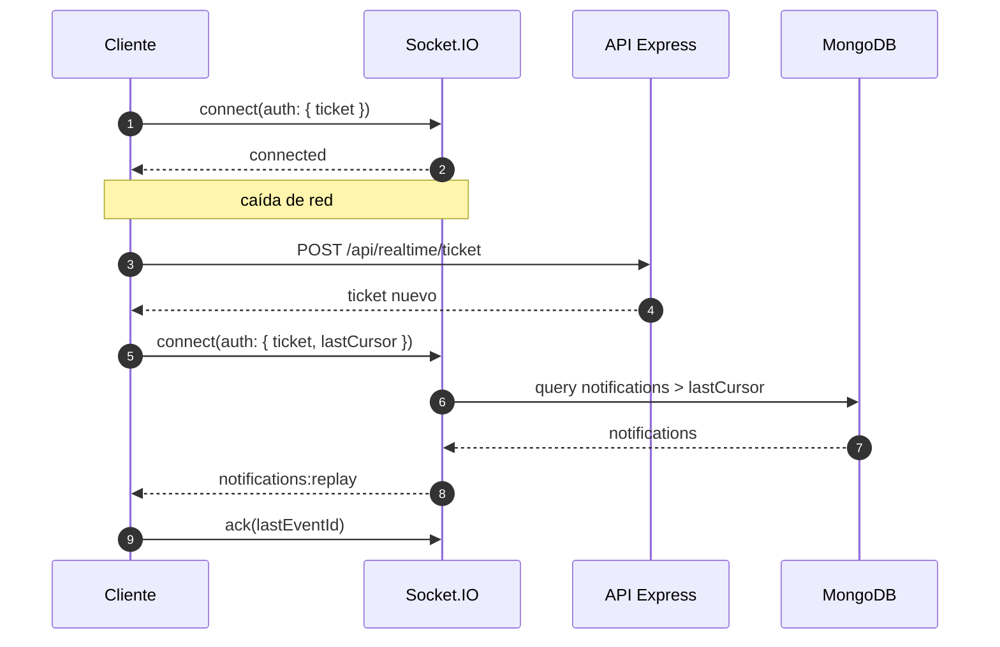

# Eventos de tiempo real — FALCONSYNC

| Campo | Valor |
|---|---|
| Versión | 1.0-draft |
| Fecha | 2026-11-13 |
| Estado | Diseño de Fase 1; **propuesto, no implementado**. D-11 y D-20 requieren aprobación. |
| Autoridad | [`PLAN-IMPLEMENTACION.md`](./PLAN-IMPLEMENTACION.md), [`ADR-004`](./ADR/ADR-004-tiempo-real.md), [`RBAC.md`](./RBAC.md) |
| Documentos relacionados | [`MODELO-DATOS.md`](./MODELO-DATOS.md), [`CASOS-USO.md`](./CASOS-USO.md), [`openapi.yaml`](./openapi.yaml) |

> Socket.IO es un requisito duro. Este documento define el contrato de handshake, salas,
> eventos, persistencia y reconexión. No declara que el servidor Socket.IO exista: el backend
> actual solo crea un servidor HTTP en `bin/server.js`.

## 1. Principios

1. **La notificación se persiste antes de emitirse.** Socket.IO no es la fuente de verdad.
2. **El servidor decide las salas.** El cliente no puede suscribirse a un usuario, rol o
   inspección arbitraria.
3. **Ticket de corta duración y un solo uso.** No se acepta el JWT de acceso en query string.
4. **Entrega al menos una vez, deduplicación en el cliente.** El `eventId` es estable.
5. **Recuperación por cursor.** Tras una desconexión, el cliente puede pedir lo perdido.
6. **Aislamiento por recurso.** Un inspector solo recibe eventos de sus inspecciones; un
   usuario solo los de sus recursos.
7. **Una instancia documentada.** Si se despliega clúster, se usa adaptador Redis y sesiones
   pegajosas; no se promete escalado horizontal sin esa configuración.

## 2. Topología

### 2.1 Una instancia (línea base de Fase 4)

```text
Angular SPA ──HTTPS──► API Express ──► MongoDB
      │                    │
      └──WebSocket─────────┘
           Socket.IO
```

- Los tickets y `jti` consumidos viven en memoria con TTL.
- Las salas viven en memoria.
- Si el proceso se reinicia, los clientes reconectan y recuperan por cursor.
- Es la topología recomendada hasta que D-20 se apruebe.

### 2.2 Clúster (si D-20 lo aprueba)

```text
                   ┌──────────────┐
Cliente ──WSS──►   │ Load balancer│
                   └──────┬───────┘
                          │ sticky
                 ┌────────┴────────┐
                 ▼                 ▼
            API instancia A   API instancia B
                 │                 │
                 └──────┬──────────┘
                        ▼
                  Redis (adapter + tickets)
                        │
                     MongoDB
```

Requisitos:

- Sesiones pegajosas en el balanceador para el handshake y las conexiones WebSocket.
- Adaptador Redis de Socket.IO para difundir eventos entre instancias.
- Almacén compartido de `jti` consumidos y salas.
- Un solo origen de cursor por usuario; no se generan cursores independientes por instancia.

## 3. Ticket de tiempo real

### 3.1 Emisión

`POST /api/realtime/ticket` (autenticado, capacidad `realtime.connect`).

Respuesta `201`:

```json
{
  "data": {
    "ticket": "<jwt>",
    "expiresIn": 60,
    "socketPath": "/socket.io"
  }
}
```

Claims del ticket:

| Claim | Valor |
|---|---|
| `sub` | ID del usuario. |
| `role` | Rol vigente. |
| `ver` | `tokenVersion` del usuario. |
| `scope` | `realtime`. |
| `jti` | UUID único del ticket. |
| `iat` / `exp` | Emisión y expiración (60 s). |

Reglas:

- El ticket se firma con un secreto distinto del access token o con un `audience` específico.
- El `jti` se registra como “no consumido” con TTL de 60 s.
- Al handshake, el servidor valida firma, `scope`, `exp`, `ver` y consume el `jti`.
- Un segundo intento con el mismo `jti` responde `401 REALTIME_TICKET_USED`.
- No se acepta el ticket en `query` ni en `Authorization` de Socket.IO; solo en `auth`.
- Si el usuario cambia de rol o se desactiva, `tokenVersion` invalida el ticket.

### 3.2 Handshake

```text
Cliente                         Servidor
  │  connect(auth: { ticket })     │
  │───────────────────────────────►│
  │                                │ valida firma/claims
  │                                │ consume jti (single-use)
  │                                │ carga User y tokenVersion
  │                                │ decide salas
  │◄───────────────────────────────│ connected
```

Salas decididas por el servidor:

| Sala | Quién entra | Condición |
|---|---|---|
| `user:<userId>` | El propio usuario | Siempre que esté activo. |
| `role:inspector` | Inspectores | Rol `inspector` y cuenta activa. |
| `inspection:<inspectionId>` | Inspector asignado, revisor asignado | Pertenencia verificada en base de datos. |

No se aceptan nombres de sala enviados por el cliente. Si el cliente intenta unirse a otra
sala, se ignora y se registra el intento.

## 4. Sobre de evento

Todos los eventos usan el mismo sobre:

```json
{
  "eventId": "6f1c2a9e-6e0f-4a6e-9f0e-2f6b1c9d7a11",
  "type": "notification.created",
  "occurredAt": "2026-11-13T14:32:10.123Z",
  "cursor": "v1:1763044330123:6f1c2a9e-6e0f-4a6e-9f0e-2f6b1c9d7a11",
  "aggregateType": "Inspection",
  "aggregateId": "665f1c2a9e6e0f4a6e9f0e2f",
  "correlationId": "req-7f3c1a",
  "payload": {}
}
```

| Campo | Obligatorio | Regla |
|---|---:|---|
| `eventId` | Sí | UUID estable; deduplicación. |
| `type` | Sí | Catálogo de la sección 5. |
| `occurredAt` | Sí | ISO 8601 UTC. |
| `cursor` | Sí | Solo para eventos persistidos; formato `v1:<epochMillis>:<eventId>`. |
| `aggregateType` | Sí | `Report`, `Inspection`, `Intervention`, `Evidence`, `HeritageAsset`, `Location`, `Panorama`. |
| `aggregateId` | Sí | ID público del agregado. |
| `correlationId` | No | Trazabilidad de la solicitud. |
| `payload` | Sí | Datos mínimos; sin evidencia binaria, tokens ni datos personales innecesarios. |

## 5. Catálogo de eventos

| Evento | Agregado | Sala | ¿Notificación persistida? | Disparador |
|---|---|---|---:|---|
| `notification.created` | `Notification` | `user:<id>` | Sí | Se crea una notificación para un usuario. |
| `report.created` | `Report` | `role:inspector` | No; la alerta a inspectores se persiste como notificación | Reporte nuevo. |
| `report.triaged` | `Report` | `user:<reporterId>` | Sí | Triaje aceptado/rechazado/cerrado. |
| `report.converted` | `Report` | `user:<reporterId>`, `inspection:<id>` | Sí | Conversión en inspección. |
| `inspection.updated` | `Inspection` | `inspection:<id>`, `role:inspector` | No; es una señal de UI | Cambio de estado o asignación. |
| `inspection.assigned` | `Inspection` | `user:<inspectorId>`, `inspection:<id>` | Sí | Asignación o reasignación. |
| `inspection.submitted` | `Inspection` | `role:inspector`, `inspection:<id>` | Sí | Envío a revisión. |
| `inspection.returned` | `Inspection` | `user:<inspectorId>`, `inspection:<id>` | Sí | Revisión devuelta. |
| `inspection.reviewed` | `Inspection` | `inspection:<id>` | Sí | Revisión aprobada. |
| `inspection.closed` | `Inspection` | `user:<reporterId>`, `inspection:<id>` | Sí | Cierre. |
| `intervention.verified` | `Intervention` | `inspection:<id>` | Sí | Verificación. |
| `evidence.available` | `Evidence` | `user:<uploadedBy>`, `inspection:<id>` | Sí | Evidencia disponible tras análisis. |
| `conservation.projected` | `Location` | Ninguna | No | Proyección pública actualizada. |

Reglas:

- `notification.created` es el evento que el cliente usa para actualizar el centro de
  notificaciones. Su `payload` incluye `notificationId`, `type`, `title`, `body`, `resource`
  y `cursor`.
- `inspection.updated` no reemplaza la consulta del detalle; solo indica que el cliente debe
  refrescar.
- `report.created` puede emitirse a `role:inspector` para la bandeja; la notificación
  persistida se crea para cada inspector que corresponda.
- Un evento sin sala aplicable no se emite, pero el `DomainEvent` y la notificación siguen
  persistidos.

## 6. Persistencia y entrega

### 6.1 Orden de operaciones

1. La transición de dominio se valida.
2. Se persiste el cambio de estado.
3. Se persiste `DomainEvent` (obligatorio).
4. Se persiste `Notification` para cada destinatario (si aplica).
5. Se emite el evento Socket.IO.
6. El cliente confirma con `ack`.

Si el paso 4 falla, el evento de dominio sigue existiendo; un job de reintento puede crear la
notificación. Si el paso 5 falla, la notificación queda recuperable por API.

### 6.2 Cursor

- Formato: `v1:<epochMillis>:<eventId>`.
- Orden lexicográfico estable; el `eventId` desempata.
- `GET /api/notifications?cursor=<lastCursor>&limit=50` devuelve las notificaciones
  posteriores.
- El cliente guarda el último cursor confirmado.
- Al reconectar, envía `lastCursor` en el handshake o emite `notifications:resume` con
  `{ lastCursor }`.
- El servidor responde con `notifications:replay` y los eventos perdidos, en orden.
- Si el cursor es inválido, responde `400 INVALID_CURSOR` y el cliente recarga desde cero.

### 6.3 Deduplicación

- El cliente mantiene un conjunto acotado de `eventId` vistos (por ejemplo, últimos 500).
- Si recibe un `eventId` repetido, no vuelve a mostrar la notificación ni a ejecutar la acción.
- El servidor no reemite un evento ya confirmado salvo en un replay solicitado.
- `Notification.eventId` es único; dos intentos de persistir la misma notificación no crean
  duplicados.

### 6.4 Ack

- El servidor emite con callback de Socket.IO.
- El cliente responde `ack({ eventId })`.
- El servidor registra métrica de entrega; no cambia el estado de lectura.
- Si no hay `ack` en 5 s, el servidor puede reintentar una vez; el cliente deduplica.
- La lectura se marca explícitamente con `POST /api/notifications/:id/read`.

## 7. Reconexión



Reglas:

- Backoff exponencial con jitter: 1 s, 2 s, 4 s, 8 s, máximo 30 s.
- No se reconecta en bucle si el servidor responde `401` o `403`; se solicita sesión/ticket
  nuevo y se muestra un aviso.
- Si el usuario cambió de rol, el ticket anterior falla; el cliente debe volver a iniciar
  sesión o refrescar el token.
- Si el servidor reinicia, las notificaciones se recuperan por cursor.
- El cliente muestra “Reconectando…” y “Sin conexión” sin bloquear la navegación.

## 8. Límites y frecuencia

| Límite | Propuesta | Motivo |
|---|---|---|
| Conexiones por usuario | 3 | Evitar abuso y pestañas duplicadas. |
| Tickets por minuto | 10 | Evitar emisión masiva. |
| Eventos por segundo al cliente | 20 | Evitar tormentas. |
| Tamaño de payload | 16 KB | Mantener el sobre pequeño. |
| Replay por solicitud | 100 notificaciones | Evitar respuestas enormes. |
| TTL de ticket | 60 s | Ventana corta. |
| TTL de `jti` | 60 s | Consumo único. |

Si se supera un límite, el servidor emite `error` con `RATE_LIMITED` y puede cerrar la
conexión. El cliente aplica backoff.

## 9. Errores de tiempo real

| Código | HTTP/handshake | Cuándo | Acción del cliente |
|---|---|---|---|
| `REALTIME_TICKET_REQUIRED` | 401 | Handshake sin ticket. | Solicitar ticket. |
| `REALTIME_TICKET_INVALID` | 401 | Firma/claims inválidos. | Solicitar ticket nuevo. |
| `REALTIME_TICKET_EXPIRED` | 401 | Ticket vencido. | Solicitar ticket nuevo. |
| `REALTIME_TICKET_USED` | 401 | `jti` ya consumido. | Solicitar ticket nuevo. |
| `REALTIME_FORBIDDEN` | 403 | Sala/recurso no autorizado. | No reintentar; verificar asignación. |
| `REALTIME_RATE_LIMITED` | 429 | Límite de conexiones/tickets/eventos. | Backoff y aviso. |
| `INVALID_CURSOR` | 400 | Cursor mal formado. | Recargar notificaciones desde cero. |
| `REALTIME_UNAVAILABLE` | 503 | Servidor no disponible. | Backoff; la API sigue disponible. |

El cliente nunca muestra el mensaje técnico crudo; usa un texto accionable y registra el
código para soporte.

## 10. Seguridad y privacidad

- El ticket no se registra en logs ni en la URL.
- El `jti` se consume una sola vez; el almacén debe ser atómico.
- Las salas se recalculan al conectar y al cambiar de rol; no se confía en el cliente.
- Un evento de inspección no incluye evidencia, identidad del reportante ni notas internas.
- Un usuario solo recibe notificaciones de sus recursos.
- Un inspector solo recibe eventos de inspecciones asignadas o de la bandeja general de
  inspectores, según el evento.
- Un admin no entra en `inspection:<id>` por su rol; solo auditoría por API.
- Los payloads se validan y se limitan; no se reenvían objetos completos de Mongoose.
- Los errores de handshake no revelan si un recurso existe.

## 11. Despliegue y proxy

### 11.1 Nginx

```nginx
location /socket.io/ {
    proxy_pass http://falconsync_api;
    proxy_http_version 1.1;
    proxy_set_header Upgrade $http_upgrade;
    proxy_set_header Connection "upgrade";
    proxy_set_header Host $host;
    proxy_set_header X-Forwarded-For $proxy_add_x_forwarded_for;
    proxy_set_header X-Forwarded-Proto $scheme;
    proxy_read_timeout 75s;
    proxy_send_timeout 75s;
}
```

El timeout debe ser mayor que el heartbeat de Socket.IO. El heartbeat propuesto es 25 s con
timeout de 20 s; el proxy usa 75 s.

### 11.2 CORS y origen

- El origen permitido es el mismo `CORS_ORIGIN` de la API.
- `credentials: true` solo si se usan cookies; el ticket va en `auth`, no en cookie.
- Se rechaza un origen no permitido en el handshake.

### 11.3 Variables de entorno propuestas

| Variable | Uso | Secreto |
|---|---|---|
| `REALTIME_TICKET_SECRET` | Firma del ticket (distinto del access token). | Sí |
| `REALTIME_TICKET_TTL_SECONDS` | TTL, por defecto 60. | No |
| `REALTIME_MAX_CONNECTIONS_PER_USER` | Límite, por defecto 3. | No |
| `REALTIME_REDIS_URL` | Adaptador y `jti` en clúster. | Sí |
| `REALTIME_CORS_ORIGIN` | Origen permitido si difiere del general. | No |

No se incluyen valores reales en `.env.example`; solo marcadores.

## 12. Observabilidad

Métricas propuestas:

- conexiones activas por rol;
- tickets emitidos, consumidos, expirados y reutilizados;
- eventos emitidos, confirmados y reenviados;
- latencia desde persistencia hasta `ack` (SLO-08: p95 ≤ 2 s);
- desconexiones por código;
- tamaño de replay y cursores inválidos;
- errores de autorización de sala.

Logs estructurados con `correlationId`, `userId` (sin email), `eventId`, `type` y resultado.
No se registran tickets ni payloads con datos personales.

## 13. Matriz de pruebas

| Caso | Resultado esperado |
|---|---|
| Handshake sin ticket | `401 REALTIME_TICKET_REQUIRED`. |
| Ticket expirado | `401 REALTIME_TICKET_EXPIRED`. |
| Ticket reutilizado | `401 REALTIME_TICKET_USED`. |
| Ticket en query string | Rechazado. |
| Usuario A intenta `user:B` | No entra; evento de seguridad. |
| Inspector A intenta `inspection:B` | `403 REALTIME_FORBIDDEN`. |
| Admin intenta sala de inspección | `403`; solo auditoría por API. |
| Notificación persistida antes de emitir | La API la devuelve aunque Socket.IO falle. |
| Duplicado por `eventId` | El cliente no duplica. |
| Reconexión con `lastCursor` | Replay en orden, sin huecos. |
| Cursor inválido | `400 INVALID_CURSOR`; recarga. |
| Límite de conexiones | `429 REALTIME_RATE_LIMITED`. |
| Carga de 100 clientes | p95 de entrega dentro del SLO o reporte de desviación. |
| Reinicio del servidor | Clientes reconectan y recuperan. |
| Clúster sin Redis | No se declara soportado; se documenta la limitación. |

## 14. Decisiones pendientes

- **D-11:** Socket.IO para notificaciones; el chat puede usar HTTP/SSE. Este documento asume
  Socket.IO solo para notificaciones y señales de inspección.
- **D-20:** instancia única o clúster. La línea base es una instancia; el clúster exige Redis
  y sesiones pegajosas.
- **Retención de notificaciones:** D-23; propuesta 180 días.
- **Push del navegador:** fuera de alcance; no se promete notificación con la pestaña cerrada.
- **Chat:** si se implementa, su transporte se decide aparte; no se acopla a este contrato.
