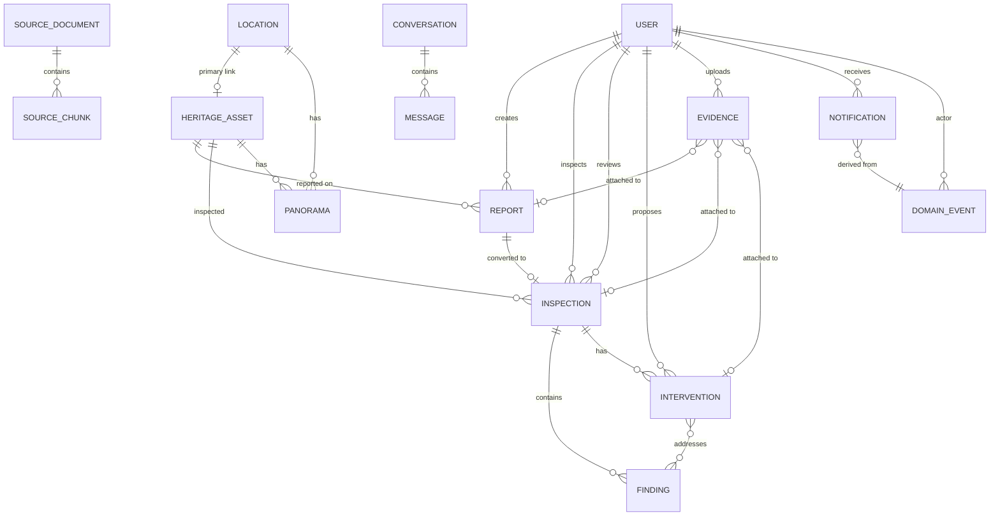
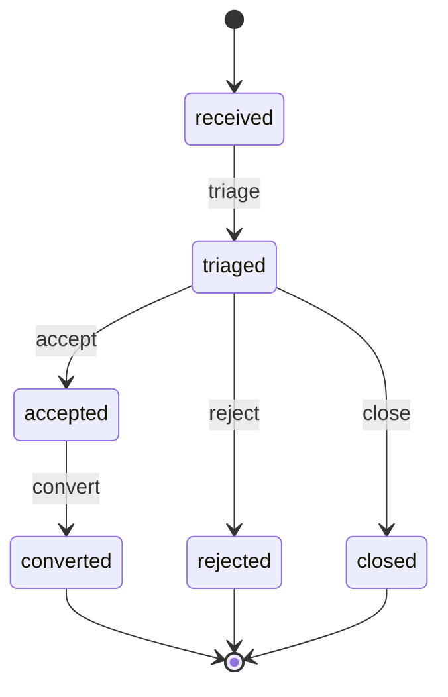
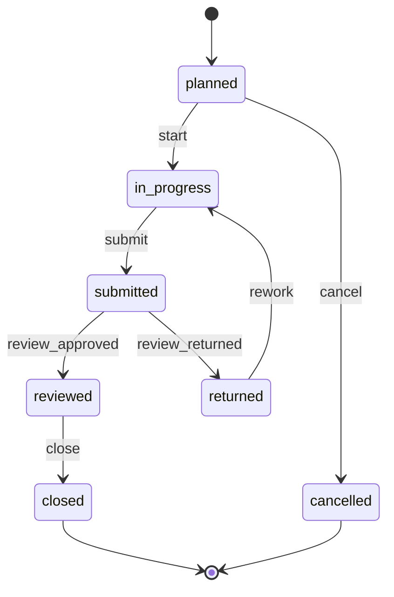
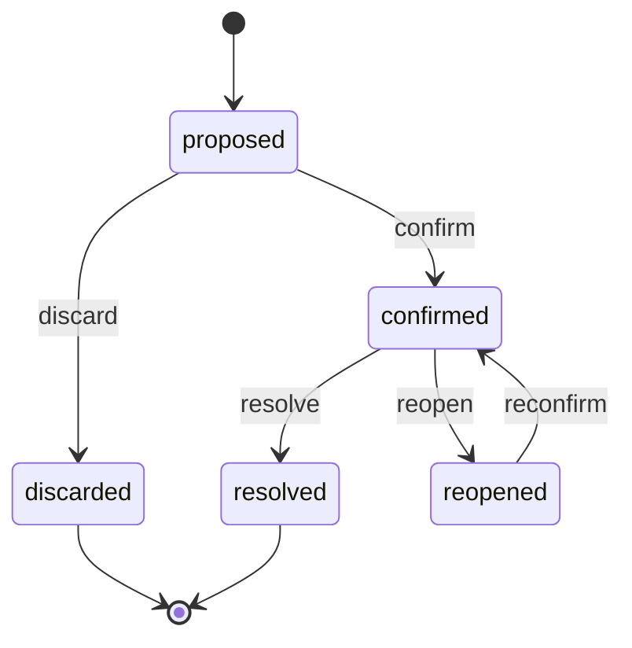
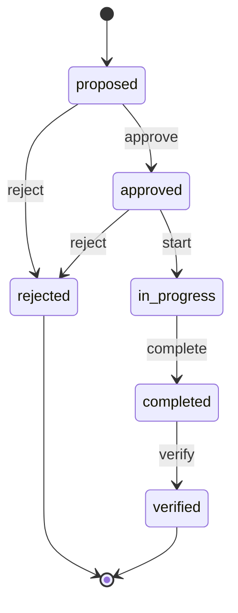
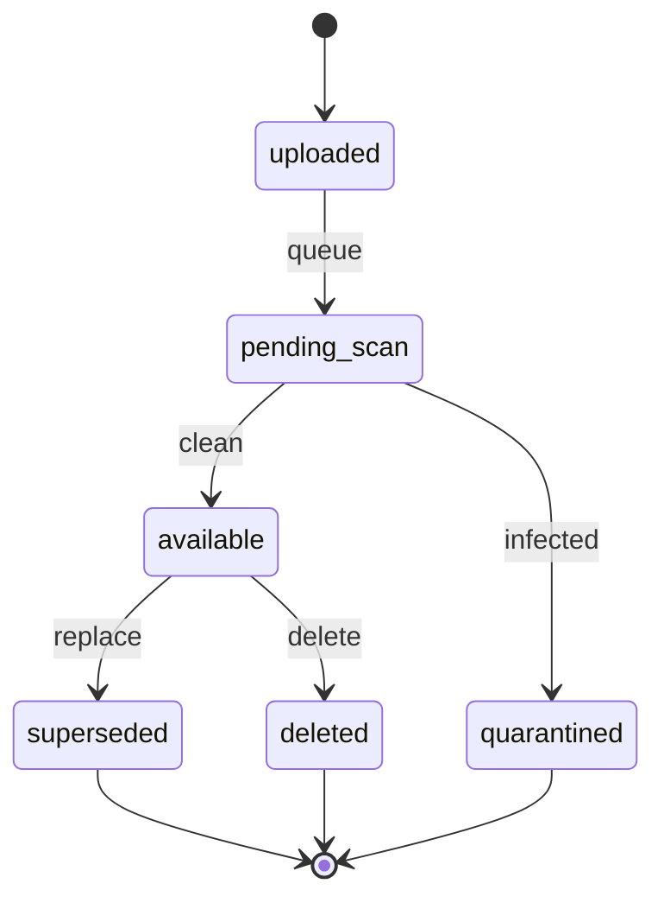
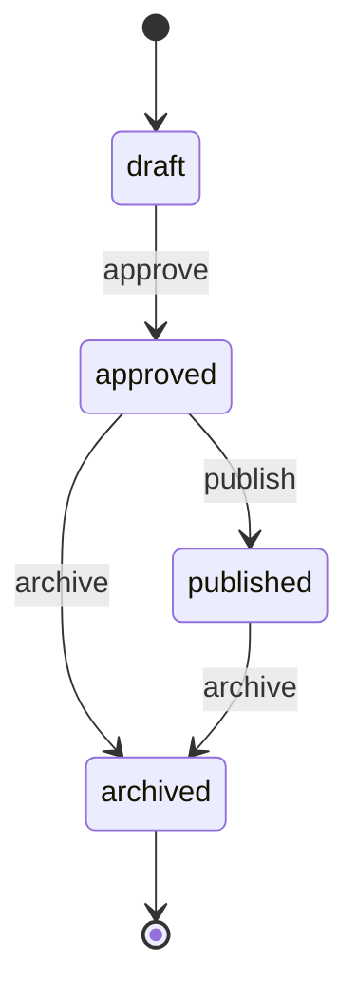
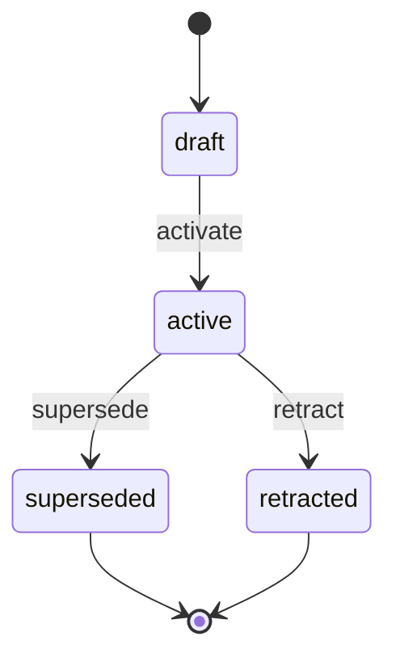

# Modelo de datos y dominio de conservación — FALCONSYNC

| Campo | Valor |
|---|---|
| Versión | 1.0-draft |
| Fecha | 2026-11-13 |
| Estado | Diseño de Fase 1; **backend parcialmente implementado**. D-09 a D-17 aprobadas el 2026-11-13; el contrato integral, D-23 y las decisiones FD-* siguen pendientes. |
| Autoridad | [`PLAN-IMPLEMENTACION.md`](./PLAN-IMPLEMENTACION.md), [`REQUISITOS.md`](./REQUISITOS.md), [`RBAC.md`](./RBAC.md) |
| Documentos relacionados | [`openapi.yaml`](./openapi.yaml), [`CASOS-USO.md`](./CASOS-USO.md), [`EVENTOS-TIEMPO-REAL.md`](./EVENTOS-TIEMPO-REAL.md), [`WIREFRAMES.md`](./WIREFRAMES.md), [`360.md`](./360.md), [`ADR-001`](./ADR/ADR-001-separacion-dominio.md), [`ADR-003`](./ADR/ADR-003-evidencia-auditoria.md) |

> Este documento describe el modelo **objetivo** del dominio de conservación. El árbol de
> trabajo ya contiene modelos, servicios y rutas parciales para `HeritageAsset`, `Report`,
> `Inspection`, `Intervention` y `DomainEvent`. Aún no están implementados `Evidence`,
> `EvidenceAccessLog`, notificaciones, RAG ni visita 360°; tampoco está completa la UI o la
> autorización por recurso. Los 23 POI siguen en `conservationStatus: unknown`.

## 1. Alcance y principios

El modelo cubre:

- el inventario patrimonial inspeccionable (`HeritageAsset`);
- el aviso ciudadano (`Report`);
- la actuación técnica (`Inspection`) con hallazgos embebidos (`Finding`);
- la obra o acción de conservación (`Intervention`);
- la evidencia privada (`Evidence`) y su registro de acceso (`EvidenceAccessLog`);
- el historial inmutable (`DomainEvent`);
- las notificaciones persistentes (`Notification`);
- el corpus RAG (`SourceDocument`, `SourceChunk`, `Conversation`, `Message`);
- la visita 360° (`Panorama`, `AudioGuide` condicional);
- registros auxiliares de idempotencia y tickets de tiempo real.

Principios:

1. **Separación de conceptos.** Un POI turístico no es un activo patrimonial; un reporte no
   es un diagnóstico; una inspección no es una intervención.
2. **Fuente de verdad única por hecho.** Las transiciones críticas viven en `DomainEvent`.
   `Inspection.history` y `Location.conservationStatus` son read models derivados.
3. **Append-only.** `DomainEvent` y `EvidenceAccessLog` no admiten actualización ni borrado.
4. **Privacidad por diseño.** La identidad del reportante y la evidencia nunca se publican.
5. **Concurrencia optimista.** Toda transición crítica usa `version` y `If-Match`.
6. **Idempotencia.** Las operaciones que crean recursos o cierran ciclos aceptan
   `Idempotency-Key` y no duplican efectos.
7. **No inventar patrimonio.** `unescoStatus` se registra con fuente; no se deduce del
   nombre, del circuito ni de la ubicación en el Casco Histórico.

## 2. Convenciones

| Convención | Regla |
|---|---|
| Motor | MongoDB 9 con Mongoose 9, ESM. |
| Identificador interno | `_id` de MongoDB. |
| Identificador público | `id` como cadena; nunca se expone `_id`, `storageKey`, hashes de sesión ni tokens. |
| Fechas | `Date` en UTC; la API usa ISO 8601 con `Z`. |
| Geometría | GeoJSON `Point` o `Polygon`; coordenadas `[longitud, latitud]`. |
| Precisión GPS | `accuracyMeters` en metros, tal como la informa el navegador. |
| Timestamps | `createdAt` y `updatedAt` con `timestamps: true`, salvo colecciones append-only. |
| Versión de esquema | `versionKey: false`; la concurrencia usa un campo explícito `version`. |
| Borrado | Lógico con `deletedAt`/`deletedBy` donde se conserva historial; nunca en append-only. |
| Serialización | `toJSON` transforma `_id` a `id` y elimina campos privados. |
| Enumeraciones | Constantes exportadas; no se aceptan cadenas libres. |
| Índices | Explícitos, revisados en migración; no se confía en `autoIndex` en producción. |
| Correlación | `X-Correlation-Id` opcional; si falta, el servidor genera uno y lo devuelve en logs. |
| Unidades | Metros, milisegundos, bytes y UTC; no se mezclan unidades. |

### 2.1 Colecciones y agregados

| Entidad | Colección | Tipo | Función |
|---|---|---|---|
| `User` | `users` | Existente | Identidad, rol, estado y versión de sesión. |
| `Location` | `locations` | Existente | POI público y ficha turística. |
| `HeritageAsset` | `heritageassets` | Nueva | Unidad patrimonial inspeccionable. |
| `Report` | `reports` | Nueva | Aviso autenticado, no diagnóstico. |
| `Inspection` | `inspections` | Nueva | Agregado de inspección; embebe `Finding` e historial. |
| `Intervention` | `interventions` | Nueva | Obra o acción de conservación verificable. |
| `Evidence` | `evidences` | Nueva | Metadatos de evidencia privada. |
| `EvidenceAccessLog` | `evidenceaccesslogs` | Nueva | Acceso append-only a evidencia. |
| `DomainEvent` | `domainevents` | Nueva | Hecho inmutable del dominio. |
| `Notification` | `notifications` | Nueva | Aviso persistido por usuario. |
| `SourceDocument` | `sourcedocuments` | Nueva | Fuente RAG registrada. |
| `SourceChunk` | `sourcechunks` | Nueva | Fragmento trazable de una fuente. |
| `Conversation` | `conversations` | Nueva | Conversación con un asistente. |
| `Message` | `messages` | Nueva | Mensaje y citas de una conversación. |
| `Panorama` | `panoramas` | Nueva | Escena 360° pública o de inspección. |
| `AudioGuide` | `audioguides` | Condicional | Audio, transcripción e idioma. |
| `IdempotencyRecord` | `idempotencyrecords` | Auxiliar | Respuesta almacenada para reintentos seguros. |
| `AuditLog` | `auditlogs` | Existente | Auditoría administrativa no crítica. |

### 2.2 Límites de agregado

- **`Inspection` es el agregado** de la actuación técnica. `Finding` vive embebido porque
  siempre se lee con la inspección, se revisa en conjunto y se cierra en una sola operación.
  Límite propuesto: 50 hallazgos por inspección.
- **`Intervention` es un agregado separado** porque tiene ciclo de vida, ejecutor y
  verificador propios. Se relaciona con la inspección y con uno o más `findingId`.
- **`Report` es un agregado separado.** Su conversión crea una inspección y deja un enlace
  único; no se copia el reporte dentro de la inspección.
- **`Evidence` es un agregado separado** con referencia polimórfica al dueño. El binario vive
  en almacenamiento privado, no en MongoDB.
- **`Location.conservationStatus` es una proyección cacheada**, no la fuente de verdad. Solo
  la actualiza `conservationProjectionService` a partir de una inspección cerrada y revisada.

## 3. Diagrama entidad-relación



`FINDING` es una entidad lógica embebida en `INSPECTION`; no es una colección independiente.
`EVIDENCE` usa `ownerType` + `ownerId`; el diagrama muestra las tres relaciones posibles.

## 4. Enumeraciones

| Constante | Valores | Nota |
|---|---|---|
| `USER_ROLES` | `user`, `moderator`, `historian`, `inspector`, `admin` | `moderator` es legacy temporal. |
| `ASSIGNABLE_USER_ROLES` | `user`, `historian`, `inspector`, `admin` | No se asigna `moderator` desde la API. |
| `HERITAGE_ASSET_TYPES` | `building`, `monument`, `urban_space`, `archaeological_site`, `museum`, `natural_site`, `other` | No se deriva del `Location.category`. |
| `HERITAGE_ASSET_STATUSES` | `draft`, `active`, `archived` | `active` es inspeccionable; `archived` no. |
| `UNESCO_STATUSES` | `inscribed`, `buffer_zone`, `not_listed`, `unknown` | Se registra con fuente; nunca automático. |
| `PROTECTION_LEVELS` | `national`, `state`, `municipal`, `none`, `unknown` | Declaración administrativa, no técnica. |
| `DAMAGE_CATEGORIES` | `structural`, `moisture`, `cracks`, `material_loss`, `vandalism`, `vegetation`, `fire`, `collapse_risk`, `other` | Se usa en reportes y hallazgos. |
| `REPORT_STATES` | `received`, `triaged`, `accepted`, `rejected`, `converted`, `closed` | `converted`, `rejected` y `closed` son terminales. |
| `TRIAGE_DECISIONS` | `accept`, `reject`, `close` | Se registra en `triage`. |
| `INSPECTION_TYPES` | `routine`, `follow_up`, `emergency`, `post_intervention` | `follow_up` cubre reportes convertidos. |
| `INSPECTION_STATES` | `planned`, `in_progress`, `submitted`, `returned`, `reviewed`, `closed`, `cancelled` | `closed` y `cancelled` son terminales. |
| `INSPECTION_RESULTS` | `good`, `fair`, `poor` | Se fija al revisar; alimenta la proyección pública. |
| `SEVERITIES` | `low`, `medium`, `high`, `critical` | Propuesta y confirmada son campos distintos. |
| `FINDING_STATES` | `proposed`, `confirmed`, `discarded`, `reopened`, `resolved` | `discarded` y `resolved` son terminales. |
| `INTERVENTION_TYPES` | `repair`, `stabilization`, `cleaning`, `restoration`, `monitoring`, `other` | No implica diagnóstico. |
| `INTERVENTION_STATES` | `proposed`, `approved`, `in_progress`, `completed`, `verified`, `rejected` | Solo `verified` cuenta para el cierre. |
| `EVIDENCE_OWNER_TYPES` | `Report`, `Inspection`, `Intervention` | `Finding` se referencia con `findingId` cuando el dueño es `Inspection`. |
| `EVIDENCE_SCAN_STATUSES` | `uploaded`, `pending_scan`, `available`, `quarantined`, `superseded`, `deleted` | `uploaded` es transitorio. |
| `EVIDENCE_ACTIONS` | `view`, `download`, `metadata`, `delete`, `legal_hold` | Registro append-only. |
| `DOMAIN_AGGREGATE_TYPES` | `Report`, `Inspection`, `Intervention`, `Evidence`, `HeritageAsset`, `Location`, `Panorama` | Tipos de agregado. |
| `NOTIFICATION_TYPES` | `report.created`, `report.triaged`, `report.converted`, `inspection.assigned`, `inspection.submitted`, `inspection.returned`, `inspection.reviewed`, `inspection.closed`, `intervention.verified`, `evidence.available`, `system` | Catálogo inicial. |
| `SOURCE_LEVELS` | `A`, `B`, `C`, `D`, `E` | Niveles de [`FUENTES-RAG.md`](./FUENTES-RAG.md). |
| `SOURCE_STATUSES` | `draft`, `active`, `superseded`, `retracted` | Una versión nueva no borra la anterior. |
| `ACCESS_LEVELS` | `public`, `internal`, `restricted` | Controla recuperación y citas. |
| `PANORAMA_STATUSES` | `draft`, `approved`, `published`, `archived` | Solo `published` es público. |
| `PANORAMA_VISIBILITY` | `public`, `inspection` | `inspection` nunca se sirve por la API turística. |
| `AUDIO_GUIDE_STATUSES` | `draft`, `approved`, `published`, `archived` | Condicional a D-18. |
| `ASSISTANTS` | `tourist`, `inspection` | Políticas distintas de fuentes. |
| `MESSAGE_ROLES` | `user`, `assistant`, `system` | `system` no se muestra al usuario. |

## 5. Diccionario de datos

### 5.1 `User` (existente; sin cambios de esquema)

| Campo | Tipo | Obligatorio | Regla |
|---|---|---:|---|
| `name` | String(80) | Sí | 2–80 caracteres. |
| `username` | String(30) | No | Único si existe; minúsculas. |
| `email` | String(254) | Sí | Único; minúsculas. |
| `passwordHash` | String | Sí | `select: false`; nunca se serializa. |
| `role` | Enum `USER_ROLES` | Sí | Por defecto `user`. |
| `isActive` | Boolean | Sí | Por defecto `true`. |
| `mustChangePassword` | Boolean | Sí | Bloquea rutas protegidas hasta el cambio. |
| `tokenVersion` | Number | Sí | Se incrementa al revocar sesiones. |
| `lastLoginAt` | Date | No | Último acceso exitoso. |

No se añaden capacidades al usuario: se calculan desde el rol. `moderator` no recibe
capacidades nuevas y no es asignable desde la administración.

### 5.2 `Location` (existente; campos de proyección)

| Campo | Tipo | Obligatorio | Regla |
|---|---|---:|---|
| `conservationStatus` | Enum `good`, `fair`, `poor`, `unknown` | Sí | **Solo lectura** para la API de POI. Lo actualiza la proyección. Por defecto `unknown`. |
| `conservationVerifiedAt` | Date \| null | No | `closedAt` de la inspección revisada que alimenta la proyección. |
| `lastInspectionId` | ObjectId \| null | No | Inspección cerrada y revisada usada por la proyección. |
| `heritageAssetId` | — | — | **No se añade**: el enlace vive en `HeritageAsset.locationId` para evitar dos fuentes de verdad. |

Los campos editoriales, geográficos y de publicación existentes se conservan. El formulario
administrativo de POI deja de aceptar `conservationStatus`; si lo recibe, responde
`VALIDATION_ERROR` o lo ignora explícitamente, según se decida en Fase 3. La opción recomendada
es rechazarlo para no dar una falsa sensación de control.

### 5.3 `HeritageAsset`

| Campo | Tipo | Obligatorio | Regla / índice |
|---|---|---:|---|
| `code` | String(40) | Sí | Único; patrón `^[A-Z0-9][A-Z0-9-]{2,39}$`. |
| `name` | String(160) | Sí | Nombre patrimonial. |
| `type` | Enum `HERITAGE_ASSET_TYPES` | Sí | Índice con `status`. |
| `locationId` | ObjectId \| null | No | Ref `Location`; índice único sparse propuesto (FD-01). |
| `unescoStatus` | Enum `UNESCO_STATUSES` | Sí | Por defecto `unknown`; índice. |
| `protectionLevel` | Enum `PROTECTION_LEVELS` | Sí | Por defecto `unknown`. |
| `address` | String(240) | No | Dirección o referencia. |
| `geometry` | GeoJSON `Point` \| `Polygon` | Condicional | Obligatorio para `active`; índice `2dsphere`. |
| `description` | String(5000) | No | Descripción técnica breve. |
| `status` | Enum `HERITAGE_ASSET_STATUSES` | Sí | Por defecto `draft`; índice. |
| `sourceRefs` | Array<String(500)> | No | URLs o referencias documentales; máximo 10. |
| `notes` | String(4000) | No | Notas internas; no públicas. |
| `createdBy` | ObjectId `User` | Sí | Actor que registra. |
| `updatedBy` | ObjectId `User` | No | Último editor. |
| `archivedAt` | Date \| null | No | Archivo lógico. |
| `deletedAt` | Date \| null | No | Borrado lógico; índice. |

Reglas:

- `code` no se reutiliza después del archivo.
- Un activo `archived` no admite nuevas inspecciones.
- `unescoStatus` requiere `sourceRefs` cuando es `inscribed` o `buffer_zone`.
- `locationId` único sparse: un POI tiene como máximo un activo primario en Fase 3. Si se
  necesita más de uno, se decide una regla explícita antes de implementar (FD-01).

### 5.4 `Report`

| Campo | Tipo | Obligatorio | Regla / índice |
|---|---|---:|---|
| `reporterId` | ObjectId `User` | Sí | Índice con `createdAt`. |
| `heritageAssetId` | ObjectId \| null | Condicional | Ref `HeritageAsset`; al menos un destino. |
| `locationId` | ObjectId \| null | Condicional | Ref `Location`; al menos un destino. |
| `category` | Enum `DAMAGE_CATEGORIES` | Sí | Categoría del aviso. |
| `description` | String(2000) | Sí | Descripción del usuario. |
| `capturedAt` | Date | Sí | No posterior a `now + 5 min`; se conserva la fecha declarada. |
| `gps` | GeoJSON `Point` \| null | No | Índice `2dsphere` si existe. |
| `accuracyMeters` | Number | No | 0–10000; se marca si supera 10 m. |
| `state` | Enum `REPORT_STATES` | Sí | Por defecto `received`; índice con `createdAt`. |
| `triage.decision` | Enum `TRIAGE_DECISIONS` | Condicional | Obligatorio desde `triaged`. |
| `triage.triagedBy` | ObjectId `User` | Condicional | Inspector que triaja. |
| `triage.triagedAt` | Date | Condicional | Fecha del triaje. |
| `triage.notes` | String(500) | No | Nota interna. |
| `rejectionReason` | String(500) | Condicional | Obligatorio para `rejected` y `closed`. |
| `inspectionId` | ObjectId \| null | Condicional | Obligatorio en `converted`; único sparse. Si no está vinculado se omite del documento para no colisionar con el índice; la API lo serializa como `null`. |
| `evidenceIds` | Array<ObjectId `Evidence`> | No | Máximo 10; no se exponen URLs. |
| `version` | Number | Sí | Por defecto 0; concurrencia optimista. |
| `createdAt` / `updatedAt` | Date | Sí | Timestamps. |

Reglas:

- Al menos uno de `heritageAssetId` o `locationId` debe existir. Si ambos existen, el activo
  debe pertenecer a ese POI (FD-09).
- El reportante no puede triajar su propio reporte.
- Un reporte abierto no modifica `Location.conservationStatus`.
- El historial se reconstruye desde `DomainEvent`; no se embebe un array duplicado.
- Antes de crear el índice único sparse sobre datos heredados, ejecutar el procedimiento de
  migración de [`OPERACION.md`](./OPERACION.md), sección 6.1. Un `null` explícito cuenta
  como valor indexado.

### 5.5 `Inspection`

| Campo | Tipo | Obligatorio | Regla / índice |
|---|---|---:|---|
| `assetId` | ObjectId `HeritageAsset` | Sí | Índice con `state`. |
| `reportId` | ObjectId \| null | No | Ref `Report`; único sparse. Se omite del documento si la inspección no nace de un reporte; la API lo serializa como `null`. |
| `inspectorId` | ObjectId `User` | Sí | Rol `inspector`; índice con `state`. |
| `reviewerId` | ObjectId `User` \| null | Obligatorio al crear/convertir; opcional en registros legacy | Inspector activo asignado antes de iniciar la inspección; distinto de `inspectorId`. |
| `type` | Enum `INSPECTION_TYPES` | Sí | Tipo de actuación. |
| `state` | Enum `INSPECTION_STATES` | Sí | Por defecto `planned`; índice. |
| `scope` | String(4000) | Sí | Alcance y método. |
| `scheduledAt` | Date \| null | No | Planificación. |
| `startedAt` | Date \| null | No | Inicio efectivo. |
| `submittedAt` | Date \| null | No | Envío a revisión. |
| `reviewedAt` | Date \| null | No | Revisión aprobada. |
| `closedAt` | Date \| null | No | Cierre. |
| `cancelledAt` | Date \| null | No | Cancelación. |
| `result` | Enum `INSPECTION_RESULTS` \| null | Condicional | Obligatorio en `reviewed` y `closed`. |
| `noFindingsDeclared` | Boolean | Sí | `true` solo si no hay hallazgos. |
| `findings` | Array<Finding> | Sí | Máximo 50; `findingId` único. |
| `history` | Array<HistoryEntry> | Sí | Read model append-only. |
| `closureJustification` | String(2000) | Condicional | Obligatorio si hay hallazgos sin intervención que requieran justificación. |
| `cancellationReason` | String(500) | Condicional | Obligatorio al cancelar. |
| `version` | Number | Sí | Por defecto 0. |
| `createdBy` / `updatedBy` | ObjectId `User` | Sí / No | Trazabilidad. |
| `createdAt` / `updatedAt` | Date | Sí | Timestamps. |

Antes de crear el índice único sparse sobre datos heredados, ejecutar el procedimiento de
migración de [`OPERACION.md`](./OPERACION.md), sección 6.1. Un `null` explícito cuenta como
valor indexado.

### 5.6 `Finding` (subdocumento de `Inspection`)

| Campo | Tipo | Obligatorio | Regla |
|---|---|---:|---|
| `findingId` | String UUID | Sí | Único dentro de la inspección. |
| `category` | Enum `DAMAGE_CATEGORIES` | Sí | Categoría del daño. |
| `description` | String(2000) | Sí | Observación técnica. |
| `severityProposed` | Enum `SEVERITIES` | Sí | La fija el inspector. |
| `severityConfirmed` | Enum `SEVERITIES` \| null | Condicional | Solo la fija el revisor. |
| `requiresIntervention` | Boolean | Sí | Si `true`, el cierre exige intervención `verified`. |
| `state` | Enum `FINDING_STATES` | Sí | Por defecto `proposed`. |
| `evidenceIds` | Array<ObjectId `Evidence`> | No | Máximo 10. |
| `proposedBy` | ObjectId `User` | Sí | Inspector. |
| `proposedAt` | Date | Sí | Fecha. |
| `confirmedBy` | ObjectId `User` \| null | Condicional | Revisor. |
| `confirmedAt` | Date \| null | Condicional | Fecha. |
| `resolution` | String(1000) | Condicional | Obligatorio al resolver o descartar. |
| `resolutionNotes` | String(1000) | No | Detalle. |

### 5.7 `InspectionHistoryEntry`

| Campo | Tipo | Obligatorio | Regla |
|---|---|---:|---|
| `eventId` | String UUID | Sí | Referencia al `DomainEvent`. |
| `eventType` | String | Sí | Tipo de evento. |
| `fromState` | Enum `INSPECTION_STATES` \| null | No | Estado anterior. |
| `toState` | Enum `INSPECTION_STATES` | Sí | Estado nuevo. |
| `actorId` | ObjectId `User` | Sí | Actor. |
| `occurredAt` | Date | Sí | Fecha. |
| `reason` | String(500) | No | Motivo. |
| `metadata` | Object | No | Datos acotados. |

El array es un read model para la UI. La fuente de verdad es `DomainEvent`; una corrección de
historial no se hace por `update`, sino por un evento nuevo que explique la corrección.

### 5.8 `Intervention`

| Campo | Tipo | Obligatorio | Regla / índice |
|---|---|---:|---|
| `inspectionId` | ObjectId `Inspection` | Sí | Índice con `state`. |
| `findingIds` | Array<String UUID> | Sí | 1–50; deben pertenecer a la inspección. |
| `type` | Enum `INTERVENTION_TYPES` | Sí | Tipo de acción. |
| `description` | String(4000) | Sí | Alcance de la obra. |
| `executor.name` | String(160) | Sí | Ejecutor humano u organización. |
| `executor.organization` | String(160) | No | Organización. |
| `executor.userId` | ObjectId `User` \| null | No | Si el ejecutor es usuario del sistema. |
| `state` | Enum `INTERVENTION_STATES` | Sí | Por defecto `proposed`. |
| `proposedBy` | ObjectId `User` | Sí | Inspector que propone. |
| `approvedBy` | ObjectId `User` \| null | Condicional | Distinto del proponente; usa `inspection.review` (FD-05). |
| `approvedAt` | Date \| null | Condicional | Fecha. |
| `startedAt` | Date \| null | Condicional | Inicio. |
| `completedAt` | Date \| null | Condicional | Fin de ejecución. |
| `verifiedBy` | ObjectId `User` \| null | Condicional | Distinto del ejecutor si es usuario. |
| `verifiedAt` | Date \| null | Condicional | Verificación. |
| `evidenceIds` | Array<ObjectId `Evidence`> | Condicional | Al menos una evidencia `available` para verificar. |
| `rejectionReason` | String(500) | Condicional | Obligatorio al rechazar. |
| `verificationNotes` | String(1000) | No | Nota del verificador. |
| `version` | Number | Sí | Por defecto 0. |
| `createdAt` / `updatedAt` | Date | Sí | Timestamps. |

### 5.9 `Evidence`

| Campo | Tipo | Obligatorio | Regla / índice |
|---|---|---:|---|
| `ownerType` | Enum `EVIDENCE_OWNER_TYPES` | Sí | Índice con `ownerId`. |
| `ownerId` | ObjectId | Sí | Debe existir y ser accesible. |
| `findingId` | String UUID \| null | No | Solo si `ownerType=Inspection`. |
| `storageKey` | String | Sí | Ruta privada; `select: false`; nunca se serializa. |
| `sha256` | String(64) | Sí | Hex minúsculas; índice. |
| `mimeType` | Enum `image/jpeg`, `image/png`, `image/webp`, `application/pdf` | Sí | Validado por firma binaria. |
| `bytes` | Number | Sí | Límite configurable; propuesta: 10 MB imagen, 20 MB PDF. |
| `width` / `height` | Number \| null | No | Solo imágenes. |
| `capturedAt` | Date \| null | No | Extraída antes de eliminar EXIF. |
| `gps` | GeoJSON `Point` \| null | No | Extraída antes de eliminar EXIF. |
| `accuracyMeters` | Number \| null | No | Precisión reportada. |
| `uploadedBy` | ObjectId `User` | Sí | Autor de la carga. |
| `scanStatus` | Enum `EVIDENCE_SCAN_STATUSES` | Sí | Por defecto `pending_scan`; índice. |
| `scanEngine` | String(80) | No | Motor de análisis. |
| `scannedAt` | Date \| null | No | Fecha del análisis. |
| `quarantineReason` | String(500) | No | Motivo de cuarentena. |
| `exifStripped` | Boolean | Sí | Debe ser `true` tras el procesamiento. |
| `retentionUntil` | Date \| null | No | D-23 pendiente; `null` significa sin borrado automático. |
| `legalHold` | Boolean | Sí | Bloquea el borrado. |
| `supersededBy` | ObjectId `Evidence` \| null | No | Reemplazo. |
| `deletedAt` / `deletedBy` | Date / ObjectId \| null | No | Borrado lógico auditado. |
| `version` | Number | Sí | Por defecto 0. |
| `createdAt` / `updatedAt` | Date | Sí | Timestamps. |

### 5.10 `EvidenceAccessLog`

| Campo | Tipo | Obligatorio | Regla |
|---|---|---:|---|
| `evidenceId` | ObjectId `Evidence` | Sí | Índice con `createdAt`. |
| `actorId` | ObjectId `User` | Sí | Actor que accede. |
| `action` | Enum `EVIDENCE_ACTIONS` | Sí | Acción registrada. |
| `ip` | String(90) | No | IP de la solicitud. |
| `userAgent` | String(300) | No | Agente. |
| `purpose` | String(300) | Sí | Motivo declarado. |
| `createdAt` | Date | Sí | Append-only. |

No hay endpoints de actualización ni borrado. La retención se define en D-23.

### 5.11 `DomainEvent`

| Campo | Tipo | Obligatorio | Regla / índice |
|---|---|---:|---|
| `eventId` | String UUID | Sí | Único. |
| `aggregateType` | Enum `DOMAIN_AGGREGATE_TYPES` | Sí | Índice compuesto. |
| `aggregateId` | ObjectId \| String | Sí | Índice compuesto. |
| `eventType` | String(80) | Sí | Catálogo estable. |
| `actorId` | ObjectId `User` \| null | No | `null` para eventos de sistema. |
| `occurredAt` | Date | Sí | Índice. |
| `fromState` | String \| null | No | Estado anterior. |
| `toState` | String \| null | No | Estado nuevo. |
| `reason` | String(500) | No | Motivo. |
| `payload` | Object | No | Datos acotados; sin secretos. |
| `correlationId` | String(80) | No | Trazabilidad. |
| `schemaVersion` | Number | Sí | Por defecto 1. |

`DomainEvent` es append-only. Si una transición crítica no puede registrar su evento, la
transición falla. No hay modo best-effort para conservación.

### 5.12 `Notification`

| Campo | Tipo | Obligatorio | Regla / índice |
|---|---|---:|---|
| `userId` | ObjectId `User` | Sí | Destinatario. |
| `eventId` | String UUID | Sí | Único; referencia al evento que la origina. |
| `type` | Enum `NOTIFICATION_TYPES` | Sí | Tipo visible. |
| `payload` | Object | Sí | Datos mínimos; sin evidencia binaria. |
| `cursor` | String(120) | Sí | Orden lexicográfico; único por usuario. |
| `readAt` | Date \| null | No | Marca de lectura. |
| `createdAt` | Date | Sí | Fecha. |

Formato propuesto de cursor (FD-04): `v1:<epochMillis>:<eventId>`. Permite ordenar y
desempatar sin depender de `_id`. La API devuelve `nextCursor` y `hasMore`.

### 5.13 `SourceDocument`

| Campo | Tipo | Obligatorio | Regla / índice |
|---|---|---:|---|
| `title` | String(300) | Sí | Título completo. |
| `institution` | String(200) | Sí | Autor o institución. |
| `version` | String(80) | Sí | Edición, revisión o fecha. |
| `publicationDate` | Date \| null | No | Fecha de publicación. |
| `retrievedAt` | Date | Sí | Fecha de obtención. |
| `pages` | Number \| null | No | Número de páginas. |
| `license` | String(200) | Sí | Licencia o condición. |
| `rights` | String(500) | Sí | Derechos de uso. |
| `accessLevel` | Enum `ACCESS_LEVELS` | Sí | Nivel de acceso. |
| `checksum` | String(64) | Sí | SHA-256 único. |
| `storageKey` | String | Sí | Ruta privada; no pública. |
| `status` | Enum `SOURCE_STATUSES` | Sí | Por defecto `draft`; índice. |
| `supersedes` | ObjectId `SourceDocument` \| null | No | Versión anterior. |
| `createdBy` / `updatedBy` | ObjectId `User` | Sí / No | Trazabilidad. |
| `createdAt` / `updatedAt` | Date | Sí | Timestamps. |

### 5.14 `SourceChunk`

| Campo | Tipo | Obligatorio | Regla / índice |
|---|---|---:|---|
| `documentId` | ObjectId `SourceDocument` | Sí | Índice compuesto. |
| `ordinal` | Number | Sí | Único con `documentId`. |
| `page` | Number \| null | No | Página de origen. |
| `section` | String(200) | No | Sección o encabezado. |
| `text` | String | Sí | Texto del fragmento. |
| `tokens` | Number | Sí | Conteo aproximado. |
| `checksum` | String(64) | Sí | Integridad del fragmento. |
| `embedding` | Array<Number> \| null | No | Solo si D-12 se aprueba y hay almacén. |
| `metadata` | Object | No | Nivel de fuente, idioma, tema. |
| `createdAt` | Date | Sí | Fecha. |

Línea base D-12: índice léxico con filtros de metadatos. `embedding` queda `null` y no se
consulta hasta que se elija almacén vectorial y se evalúe la recuperación.

### 5.15 `Conversation` y `Message`

`Conversation`:

| Campo | Tipo | Obligatorio | Regla / índice |
|---|---|---:|---|
| `userId` | ObjectId `User` \| null | No | `null` para visitante anónimo. |
| `assistant` | Enum `ASSISTANTS` | Sí | `tourist` o `inspection`. |
| `startedAt` | Date | Sí | Inicio. |
| `lastMessageAt` | Date | Sí | Último mensaje. |
| `retentionUntil` | Date | Sí | TTL propuesto: 90 días (D-23). |
| `clientKeyHash` | String(64) \| null | No | Hash para cuota anónima; no IP en claro. |

`Message`:

| Campo | Tipo | Obligatorio | Regla / índice |
|---|---|---:|---|
| `conversationId` | ObjectId `Conversation` | Sí | Índice con `createdAt`. |
| `role` | Enum `MESSAGE_ROLES` | Sí | `user`, `assistant` o `system`. |
| `content` | String | Sí | Texto mostrado. |
| `citations` | Array<Citation> | No | Cada cita referencia un `chunkId` recuperado. |
| `model` | String(80) | No | Modelo usado. |
| `latencyMs` | Number | No | Latencia. |
| `tokensIn` / `tokensOut` | Number | No | Consumo. |
| `costUsd` | Number | No | Coste estimado. |
| `createdAt` | Date | Sí | Fecha. |

`Citation`: `{ documentId, chunkId, page, section, quote, sourceLevel, sourceLabel, url }`.
La cita se valida contra el fragmento recuperado; si no coincide, se descarta la respuesta y
se abstiene.

### 5.16 `Panorama` y `AudioGuide`

`Panorama`:

| Campo | Tipo | Obligatorio | Regla / índice |
|---|---|---:|---|
| `assetId` | ObjectId `HeritageAsset` \| null | Condicional | Al menos un destino. |
| `locationId` | ObjectId `Location` \| null | Condicional | Al menos un destino. |
| `title` | String(160) | Sí | Título visible. |
| `imageKey` | String | Sí | Almacenamiento controlado; no público directo. |
| `projection` | Enum `equirectangular` | Sí | Proyección. |
| `width` / `height` | Number | Sí | Dimensiones; relación 2:1 para equirectangular. |
| `checksum` | String(64) | Sí | SHA-256. |
| `license` | String(200) | Sí | Licencia. |
| `licenseUrl` | String(500) | No | Enlace a la licencia. |
| `author` | String(160) | Sí | Autoría. |
| `credit` | String(300) | Sí | Crédito visible. |
| `capturedAt` | Date \| null | No | Fecha de captura. |
| `status` | Enum `PANORAMA_STATUSES` | Sí | Por defecto `draft`; índice. |
| `visibility` | Enum `PANORAMA_VISIBILITY` | Sí | Por defecto `public`; índice. |
| `hotspots` | Array<Hotspot> | No | Navegación. |
| `fallback` | Object | Sí | Imagen estática, alt, descripción y transcripción opcional. |
| `consent` | Object | No | Consentimiento y difuminado de personas. |
| `createdBy` / `updatedBy` | ObjectId `User` | Sí / No | Trazabilidad. |
| `createdAt` / `updatedAt` | Date | Sí | Timestamps. |

`Hotspot`: `{ hotspotId, label, type, yaw, pitch, targetPanoramaId, targetLocationId,
targetUrl, ariaLabel }`. `yaw` y `pitch` en grados; se validan rangos.

`AudioGuide` (condicional a D-18):

| Campo | Tipo | Obligatorio | Regla |
|---|---|---:|---|
| `assetId` | ObjectId `HeritageAsset` | Sí | Activo. |
| `language` | String BCP-47 | Sí | Único con `assetId`. |
| `audioKey` | String | Sí | Almacenamiento privado o controlado. |
| `transcript` | String | Sí | Transcripción completa. |
| `durationSeconds` | Number | Sí | Duración. |
| `license` | String(200) | Sí | Licencia. |
| `status` | Enum `AUDIO_GUIDE_STATUSES` | Sí | Por defecto `draft`. |
| `checksum` | String(64) | Sí | Integridad. |

### 5.17 `IdempotencyRecord` (auxiliar)

| Campo | Tipo | Obligatorio | Regla / índice |
|---|---|---:|---|
| `key` | String(120) | Sí | `Idempotency-Key` del cliente. |
| `actorId` | ObjectId `User` | Sí | Alcance por actor. |
| `method` | String(10) | Sí | Método HTTP. |
| `path` | String(300) | Sí | Ruta normalizada. |
| `requestHash` | String(64) | Sí | Hash del cuerpo relevante. |
| `statusCode` | Number | Sí | Respuesta almacenada. |
| `responseBody` | Object | No | Respuesta reproducible. |
| `createdAt` | Date | Sí | Creación. |
| `expiresAt` | Date | Sí | TTL propuesto: 24 h. |

Índice único `actorId + key`. Si la misma clave llega con otro `requestHash`, se responde
`409 IDEMPOTENCY_CONFLICT`.

### 5.18 Ticket de tiempo real (no persistido)

El ticket es un JWT de 60 segundos con `sub`, `role`, `ver`, `scope=realtime`, `jti`, `iat` y
`exp`. El `jti` se guarda en memoria (una instancia) o Redis (clúster) con TTL y se consume
una sola vez. No se persiste en MongoDB. El detalle está en
[`EVENTOS-TIEMPO-REAL.md`](./EVENTOS-TIEMPO-REAL.md).

## 6. Relaciones y cardinalidades

| Relación | Cardinalidad | Regla |
|---|---|---|
| `User` → `Report` | 1:N | Un usuario crea muchos reportes; cada reporte tiene un dueño. |
| `User` → `Inspection` | 1:N | Inspector asignado; revisor distinto. |
| `User` → `Intervention` | 1:N | Proponente, aprobador, ejecutor y verificador son referencias distintas según el caso. |
| `User` → `Evidence` | 1:N | Autor de la carga. |
| `Location` → `HeritageAsset` | 1:0..1 | Enlace primario propuesto; ver FD-01. |
| `HeritageAsset` → `Report` | 1:N | Un activo recibe varios avisos. |
| `HeritageAsset` → `Inspection` | 1:N | Un activo acumula inspecciones. |
| `Report` → `Inspection` | 1:0..1 | Conversión única; `Report.inspectionId` único sparse. |
| `Inspection` → `Finding` | 1:N | Embebidos; máximo 50. |
| `Inspection` → `Intervention` | 1:N | Una inspección puede requerir varias intervenciones. |
| `Intervention` → `Finding` | N:M | Por `findingIds`; deben pertenecer a la misma inspección. |
| `Evidence` → dueño | N:1 | `ownerType` + `ownerId`; `findingId` opcional. |
| `DomainEvent` → `Notification` | 1:N | Un evento puede generar varias notificaciones. |
| `SourceDocument` → `SourceChunk` | 1:N | Fragmentos ordenados por `ordinal`. |
| `Conversation` → `Message` | 1:N | Orden cronológico. |
| `HeritageAsset`/`Location` → `Panorama` | 1:N | Público o inspección. |

## 7. Índices

| Colección | Índice | Propósito |
|---|---|---|
| `heritageassets` | `{ code: 1 }` único | Código estable. |
| `heritageassets` | `{ locationId: 1 }` único sparse | Un activo primario por POI (FD-01). |
| `heritageassets` | `{ type: 1, status: 1 }` | Inventario. |
| `heritageassets` | `{ unescoStatus: 1 }` | Filtro patrimonial. |
| `heritageassets` | `{ geometry: '2dsphere' }` | Consultas espaciales. |
| `reports` | `{ state: 1, createdAt: -1 }` | Bandeja de triaje. |
| `reports` | `{ reporterId: 1, createdAt: -1 }` | Mis reportes. |
| `reports` | `{ inspectionId: 1 }` único sparse | Conversión única. |
| `reports` | `{ heritageAssetId: 1, createdAt: -1 }` | Historial por activo. |
| `reports` | `{ locationId: 1, createdAt: -1 }` | Historial por POI. |
| `reports` | `{ gps: '2dsphere' }` | Proximidad. |
| `inspections` | `{ assetId: 1, state: 1 }` | Inspecciones por activo. |
| `inspections` | `{ inspectorId: 1, state: 1 }` | Bandeja del inspector. |
| `inspections` | `{ reviewerId: 1, state: 1 }` | Bandeja del revisor. |
| `inspections` | `{ state: 1, scheduledAt: 1 }` | Planificación. |
| `inspections` | `{ reportId: 1 }` único sparse | Origen único. |
| `interventions` | `{ inspectionId: 1, state: 1 }` | Intervenciones por inspección. |
| `interventions` | `{ findingIds: 1 }` | Hallazgos cubiertos. |
| `interventions` | `{ state: 1, completedAt: -1 }` | Pendientes de verificación. |
| `evidences` | `{ sha256: 1 }` | Integridad y duplicados. |
| `evidences` | `{ ownerType: 1, ownerId: 1 }` | Evidencia por recurso. |
| `evidences` | `{ scanStatus: 1, createdAt: 1 }` | Cola de análisis. |
| `evidences` | `{ retentionUntil: 1 }` | Retención. |
| `evidenceaccesslogs` | `{ evidenceId: 1, createdAt: -1 }` | Auditoría por evidencia. |
| `evidenceaccesslogs` | `{ actorId: 1, createdAt: -1 }` | Auditoría por actor. |
| `domainevents` | `{ eventId: 1 }` único | Idempotencia y deduplicación. |
| `domainevents` | `{ aggregateType: 1, aggregateId: 1, occurredAt: -1 }` | Historial de agregado. |
| `domainevents` | `{ eventType: 1, occurredAt: -1 }` | Consultas operativas. |
| `domainevents` | `{ correlationId: 1 }` | Trazabilidad. |
| `notifications` | `{ eventId: 1 }` único | Deduplicación. |
| `notifications` | `{ userId: 1, cursor: 1 }` único | Recuperación por cursor. |
| `notifications` | `{ userId: 1, readAt: 1 }` | No leídas. |
| `sourcedocuments` | `{ checksum: 1 }` único | Integridad. |
| `sourcedocuments` | `{ status: 1 }` | Corpus activo. |
| `sourcedocuments` | `{ accessLevel: 1 }` | Política de acceso. |
| `sourcechunks` | `{ documentId: 1, ordinal: 1 }` único | Orden. |
| `sourcechunks` | `{ documentId: 1, page: 1 }` | Citas por página. |
| `sourcechunks` | índice de texto sobre `text` | Línea base léxica (D-12). |
| `conversations` | `{ userId: 1, startedAt: -1 }` | Historial. |
| `conversations` | `{ retentionUntil: 1 }` TTL | Retención. |
| `messages` | `{ conversationId: 1, createdAt: 1 }` | Orden. |
| `panoramas` | `{ assetId: 1, status: 1 }` | Panoramas por activo. |
| `panoramas` | `{ locationId: 1, status: 1 }` | Panoramas por POI. |
| `panoramas` | `{ status: 1, visibility: 1 }` | Catálogo público. |
| `audioguides` | `{ assetId: 1, language: 1 }` único | Un audio por idioma. |
| `idempotencyrecords` | `{ actorId: 1, key: 1 }` único | Reintentos seguros. |
| `idempotencyrecords` | `{ expiresAt: 1 }` TTL | Limpieza. |

Los índices se crean con un script de migración revisado. No se habilita `autoIndex` en
producción.

## 8. Máquinas de estado

### 8.1 `Report`



| Desde | Hasta | Actor / capacidad | Precondiciones | Efectos | Error |
|---|---|---|---|---|---|
| `received` | `triaged` | Inspector `report.triage` | Reporte existe; actor ≠ reportante | Registra `triage`, evento y notificación. | `FORBIDDEN`, `INVALID_TRANSITION` |
| `triaged` | `accepted` | Inspector `report.triage` | `triage.decision=accept` | Evento `report.accepted`. | `INVALID_TRANSITION` |
| `triaged` | `rejected` | Inspector `report.triage` | `rejectionReason` obligatorio | Evento `report.rejected`; notifica al reportante. | `VALIDATION_ERROR` |
| `triaged` | `closed` | Inspector `report.triage` | `rejectionReason` obligatorio | Evento `report.closed`; conserva historial. | `VALIDATION_ERROR` |
| `accepted` | `converted` | Inspector `report.triage` | `inspectionId` creado; `Idempotency-Key` | Crea inspección, enlaza y notifica. | `REPORT_ALREADY_CONVERTED`, `INVALID_TRANSITION` |

`converted`, `rejected` y `closed` son terminales. No se permite reabrir un reporte; un aviso
nuevo se registra como reporte distinto y se enlaza si corresponde.

### 8.2 `Inspection`



| Desde | Hasta | Actor / capacidad | Precondiciones | Efectos | Error |
|---|---|---|---|---|---|
| `planned` | `in_progress` | Inspector asignado `inspection.execute` | Fecha de inicio; activo `active` | `startedAt`, evento. | `FORBIDDEN`, `INVALID_TRANSITION` |
| `planned` | `cancelled` | Inspector asignado o coordinador `inspection.create` | `cancellationReason` | `cancelledAt`, evento. | `VALIDATION_ERROR` |
| `in_progress` | `submitted` | Inspector asignado `inspection.execute` | ≥1 hallazgo o `noFindingsDeclared=true` | `submittedAt`, evento, notifica al revisor. | `INSPECTION_EMPTY` |
| `submitted` | `reviewed` | Revisor `inspection.review` | Revisor ≠ inspector; resultado y severidades confirmadas | `reviewerId`, `reviewedAt`, `result`, evento. | `SELF_REVIEW_FORBIDDEN` |
| `submitted` | `returned` | Revisor `inspection.review` | `reviewNotes` obligatorio | `returnedAt`, evento, notifica al inspector. | `VALIDATION_ERROR` |
| `returned` | `in_progress` | Inspector asignado `inspection.execute` | Reanudación | Evento; conserva hallazgos. | `INVALID_TRANSITION` |
| `reviewed` | `closed` | Revisor `inspection.close` | Regla de cierre; `If-Match` | `closedAt`, proyección, evento. | `CLOSURE_REQUIRES_VERIFIED_INTERVENTION` |

`reviewed` no puede volver a `in_progress` sin un evento de corrección explícito. Si el cierre
falla por una regla de negocio, la inspección permanece `reviewed` y se corrige con una nueva
revisión o intervención, no con una transición inválida.

### 8.3 `Finding`



| Desde | Hasta | Actor / capacidad | Precondiciones | Efectos | Error |
|---|---|---|---|---|---|
| `proposed` | `confirmed` | Revisor `finding.confirm` | `severityConfirmed`; revisor ≠ inspector | Evento; confirma severidad. | `FORBIDDEN` |
| `proposed` | `discarded` | Revisor `finding.confirm` | `resolution` obligatorio | Evento; no cuenta para cierre. | `VALIDATION_ERROR` |
| `confirmed` | `resolved` | Revisor `finding.confirm` | Intervención `verified` o justificación aprobada | Evento; marca resolución. | `CLOSURE_REQUIRES_VERIFIED_INTERVENTION` |
| `confirmed` | `reopened` | Revisor `finding.confirm` | `reason` obligatorio | Evento; vuelve a evaluación. | `VALIDATION_ERROR` |
| `reopened` | `confirmed` | Revisor `finding.confirm` | Nueva evaluación | Evento. | `INVALID_TRANSITION` |

### 8.4 `Intervention`



| Desde | Hasta | Actor / capacidad | Precondiciones | Efectos | Error |
|---|---|---|---|---|---|
| `proposed` | `approved` | Revisor `inspection.review` | Actor ≠ `proposedBy`; hallazgos válidos | `approvedBy`, `approvedAt`, evento. | `SELF_APPROVAL_FORBIDDEN` |
| `proposed` | `rejected` | Revisor `inspection.review` | `rejectionReason` | Evento. | `VALIDATION_ERROR` |
| `approved` | `in_progress` | Inspector `intervention.propose` | Ejecutor definido | `startedAt`, evento. | `INVALID_TRANSITION` |
| `approved` | `rejected` | Revisor `inspection.review` | `rejectionReason` | Evento. | `VALIDATION_ERROR` |
| `in_progress` | `completed` | Inspector `intervention.propose` | Evidencia de ejecución | `completedAt`, evento. | `EVIDENCE_REQUIRED` |
| `completed` | `verified` | Inspector `intervention.verify` | Verificador ≠ ejecutor usuario; evidencia `available` | `verifiedBy`, `verifiedAt`, evento. | `SELF_VERIFY_FORBIDDEN`, `EVIDENCE_REQUIRED` |

Solo `verified` cuenta para el cierre de una inspección. Una intervención `rejected` no cuenta.

### 8.5 `Evidence`



| Desde | Hasta | Actor / sistema | Precondiciones | Efectos | Error |
|---|---|---|---|---|---|
| `uploaded` | `pending_scan` | Sistema | Archivo validado y escrito | Encola análisis. | `EVIDENCE_SCAN_UNAVAILABLE` |
| `pending_scan` | `available` | Sistema | Análisis limpio | `scannedAt`; notifica si corresponde. | — |
| `pending_scan` | `quarantined` | Sistema | Malware o fallo | `quarantineReason`; acceso bloqueado. | `EVIDENCE_QUARANTINED` |
| `available` | `superseded` | Autorizado | Reemplazo | `supersededBy`. | `FORBIDDEN` |
| `available` | `deleted` | Autorizado | Retención cumplida y sin `legalHold` | Borrado lógico y auditoría. | `LEGAL_HOLD_ACTIVE` |

### 8.6 `Panorama`



| Desde | Hasta | Actor / capacidad | Precondiciones | Efectos | Error |
|---|---|---|---|---|---|
| `draft` | `approved` | Historiador `panorama.publish` | Derechos, autoría, licencia, checksum y fallback | Evento; queda listo para publicar. | `RIGHTS_REQUIRED` |
| `approved` | `published` | Historiador `panorama.publish` | `visibility=public` o `inspection` | Visible según audiencia. | `INVALID_TRANSITION` |
| `approved` | `archived` | Historiador/admin | — | Archivo lógico. | — |
| `published` | `archived` | Historiador/admin | — | Deja de servirse. | — |

Un panorama `visibility=inspection` nunca se sirve por `/api/panoramas`.

### 8.7 `SourceDocument`



Una fuente `retracted` no se usa en respuestas nuevas; las conversaciones históricas conservan
la cita con su estado.

## 9. Invariantes

| ID | Invariante | Verificación |
|---|---|---|
| INV-01 | Un `Report` en `converted` tiene `inspectionId`; el índice es único. | Restricción + prueba. |
| INV-02 | `triage` existe desde `triaged`; `rejectionReason` existe en `rejected` y `closed`. | Validación de modelo. |
| INV-03 | `Inspection.findings` ≤ 50; `findingId` único dentro del agregado. | Validación + prueba. |
| INV-04 | `submitted` exige al menos un hallazgo o `noFindingsDeclared=true`. | Servicio + prueba. |
| INV-05 | `reviewerId` ≠ `inspectorId`, salvo `break-glass` auditado. | Servicio + prueba. |
| INV-06 | `severityConfirmed` solo la fija el revisor. | Capacidad + prueba. |
| INV-07 | El cierre exige intervención `verified` para todo hallazgo `requiresIntervention=true`. | Servicio + prueba. |
| INV-08 | `Intervention.findingIds` pertenecen a la inspección. | Validación + prueba. |
| INV-09 | `verifiedBy` ≠ `executor.userId` cuando el ejecutor es usuario. | Servicio + prueba. |
| INV-10 | Una intervención `verified` tiene al menos una evidencia `available`. | Servicio + prueba. |
| INV-11 | `Evidence.ownerType`/`ownerId` existen y el actor está autorizado. | Servicio + prueba IDOR. |
| INV-12 | El `sha256` se verifica al leer; una diferencia bloquea la entrega. | Prueba de integridad. |
| INV-13 | La evidencia nunca se sirve desde `/api/uploads`. | Prueba de rutas. |
| INV-14 | Toda transición crítica registra `DomainEvent` en la misma operación; si falla, falla la transición. | Prueba de fallo. |
| INV-15 | Las transiciones críticas incrementan `version` y respetan `If-Match`. | Prueba de concurrencia. |
| INV-16 | `Location.conservationStatus` solo lo actualiza la proyección. | Revisión + prueba. |
| INV-17 | El estado público solo se deriva de la última inspección revisada y cerrada. | Prueba de proyección. |
| INV-18 | Un reporte abierto no cambia el estado público. | Prueba de proyección. |
| INV-19 | `unescoStatus` no se deduce automáticamente. | Revisión de datos + prueba. |
| INV-20 | `Notification.eventId` es único; el cursor es único por usuario. | Índices + prueba. |
| INV-21 | El ticket de realtime es de un solo uso y no se acepta en query string. | Prueba de handshake. |
| INV-22 | Cada cita RAG referencia un `chunkId` recuperado y validado. | Prueba de citas. |
| INV-23 | Un panorama público solo se sirve si está `published`, `visibility=public` y tiene derechos. | Prueba de API. |
| INV-24 | Un panorama de inspección no aparece en la API turística. | Prueba de aislamiento. |
| INV-25 | El borrado de evidencia es lógico y respeta retención y bloqueo legal. | Prueba de retención. |
| INV-26 | `DomainEvent` y `EvidenceAccessLog` no admiten update/delete. | Revisión de rutas + prueba. |
| INV-27 | La misma `Idempotency-Key` con el mismo cuerpo devuelve la misma respuesta; con otro cuerpo devuelve conflicto. | Prueba de idempotencia. |
| INV-28 | Un revisor no aprueba su propia intervención. | Prueba de separación. |
| INV-29 | Un reporte tiene al menos un destino (`heritageAssetId` o `locationId`). | Validación. |
| INV-30 | Un POI tiene como máximo un activo primario en Fase 3. | Índice único sparse (FD-01). |

## 10. Proyección pública de conservación

### 10.1 Fuente y disparadores

La fuente de verdad es la última `Inspection` en estado `closed`, con `reviewedAt` y `result`
no nulos, del `HeritageAsset` enlazado al `Location`.

Disparadores:

1. cierre de una inspección (`reviewed → closed`);
2. reconstrucción manual con script;
3. corrección administrativa excepcional, con evento, motivo y auditoría (no permitida por
   el formulario de POI).

### 10.2 Algoritmo

```text
on inspection.closed(inspectionId):
  inspection = load(inspectionId)
  require inspection.state == closed
  require inspection.result in [good, fair, poor]
  require inspection.reviewedAt != null
  asset = load(inspection.assetId)
  if asset.locationId == null: return
  latest = findLatestClosedReviewedInspection(asset.id)
  location = load(asset.locationId)
  desired = {
    conservationStatus: map(latest.result),
    conservationVerifiedAt: latest.closedAt,
    lastInspectionId: latest.id
  }
  if location.lastInspectionId == desired.lastInspectionId:
    return  # idempotente
  update location with desired
  record DomainEvent(conservation.projected, ...)
```

`findLatestClosedReviewedInspection` ordena por `closedAt` descendente y desempata por `_id`
descendente. La actualización de `Location` es condicional para no dejar que una inspección
antigua sobrescriba una nueva.

### 10.3 Mapeo público

| `Inspection.result` | `Location.conservationStatus` | Etiqueta visible |
|---|---|---|
| `good` | `good` | Buen estado |
| `fair` | `fair` | Estado regular |
| `poor` | `poor` | Estado deficiente |
| sin inspección revisada | `unknown` | Sin inspección verificada |

La ficha pública muestra la fecha (`conservationVerifiedAt`) y un resumen no sensible:
resultado, cantidad de hallazgos por severidad y enlace ancla a la sección de conservación.
No muestra identidad del inspector, evidencia, coordenadas exactas ni notas internas.

### 10.4 Fallos y reconstrucción

- Con D-09, el cierre y la proyección se ejecutan en una transacción; si la proyección falla,
  el cierre no se confirma.
- Sin D-09, el cierre se confirma con un evento `conservation.projection_pending` y un job
  reintenta la proyección. La ficha pública no debe mostrar un estado nuevo hasta que la
  proyección se confirme; si el estado anterior queda visible, se marca como “última
  inspección verificada” con su fecha.
- `scripts/rebuildConservationProjection.js --dry-run|--apply` recalcula todos los POI
  enlazados y reporta diferencias. No se ejecuta en producción sin backup y autorización.

## 11. Concurrencia, idempotencia y atomicidad

### 11.1 Versión optimista

- `Report`, `Inspection`, `Intervention` y `Evidence` tienen `version` entero.
- La API devuelve `ETag: "<version>"` en lecturas de detalle. La inspección es la
  excepción: `GET /inspections/:id` calcula el `ETag` sobre el cuerpo completo porque
  incluye intervenciones y evidencia que cambian sin incrementar `inspection.version`.
- Las transiciones críticas exigen `If-Match: "<version>"`. Si falta, `428
  PRECONDITION_REQUIRED`; si no coincide, `409 VERSION_CONFLICT`.
- `expectedVersion` en el cuerpo es una alternativa para clientes que no pueden usar
  cabeceras; si se envían ambos, deben coincidir.

### 11.2 Idempotencia

- Cabecera `Idempotency-Key` en `POST /api/reports`, `POST /api/reports/:id/convert`,
  `POST /api/inspections`, `POST /api/interventions` y `POST /api/evidence`.
- Alcance: `actorId + key`; TTL 24 h.
- Mismo cuerpo → misma respuesta y código; cuerpo distinto → `409 IDEMPOTENCY_CONFLICT`.
- La conversión de reporte también se protege con `Report.inspectionId` único sparse.

### 11.3 Límites transaccionales

Con D-09 aprobada, se usan transacciones para:

| Operación | Documentos |
|---|---|
| Convertir reporte | `Report`, `Inspection`, `DomainEvent`, `Notification`. |
| Enviar inspección | `Inspection`, `DomainEvent`, `Notification`. |
| Revisar inspección | `Inspection`, `DomainEvent`, `Notification`. |
| Cerrar inspección | `Inspection`, `Location` (proyección), `DomainEvent`, `Notification`. |
| Verificar intervención | `Intervention`, `DomainEvent`, `Notification`. |
| Subir evidencia | Archivo privado + `Evidence` + `DomainEvent`; el archivo se escribe antes y se elimina si falla la metadata. |

Sin D-09:

- se usan agregados embebidos e idempotencia;
- no se promete atomicidad multi-documento;
- se usa un patrón outbox/retry para notificaciones y proyección;
- la puerta de Fase 3 exige decidir y probar una de las dos variantes.

### 11.4 Notificaciones

La notificación se persiste antes de emitirse. Si la emisión Socket.IO falla, la notificación
sigue disponible por `GET /api/notifications` y el cliente la recupera por cursor. El evento
de dominio no se elimina.

## 12. Evidencia, integridad y retención

### 12.1 Almacenamiento

- Raíz privada: `UPLOAD_PRIVATE_DIR`, nunca `UPLOAD_DIR` ni `/api/uploads`.
- Ruta propuesta: `evidence/<ownerType>/<ownerId>/<yyyy>/<mm>/<uuid>.<ext>`.
- `storageKey` es interno y no se serializa.
- El binario se sirve solo por `GET /api/evidence/:id` con autorización y registro.

### 12.2 Carga

1. Validar tamaño y `multipart`.
2. Detectar MIME por firma binaria; no confiar en la extensión ni en el `Content-Type`.
3. Decodificar la imagen o PDF; verificar dimensiones y estructura.
4. Extraer `capturedAt`, GPS y precisión antes de eliminar EXIF.
5. Eliminar metadatos EXIF.
6. Calcular SHA-256.
7. Escribir en almacenamiento privado con nombre aleatorio.
8. Crear `Evidence` en `pending_scan`.
9. Encolar análisis antimalware.

Si no hay motor de análisis en producción, la subida se desactiva y responde
`503 EVIDENCE_SCAN_UNAVAILABLE`; no se declara “segura” sin análisis.

### 12.3 Acceso

- Autorizar por `ownerType` + `ownerId` y capacidad.
- Registrar `EvidenceAccessLog` antes de transmitir.
- Verificar `sha256` al leer; si no coincide, `409 EVIDENCE_INTEGRITY_FAILED` y alerta.
- `Cache-Control: private, no-store`; no se usa CDN pública.
- `Content-Disposition` con nombre seguro; no se refleja el nombre original sin sanear.

### 12.4 Retención propuesta (D-23 pendiente)

| Dato | Retención propuesta | Nota |
|---|---|---|
| Evidencia de reporte | 2 años | Configurable. |
| Evidencia de inspección/intervención | 10 años | Registro patrimonial. |
| Conversaciones RAG | 90 días | Minimización. |
| Notificaciones | 180 días | No es fuente de verdad. |
| `DomainEvent` | 10 años | Append-only; revisar obligación legal. |
| `EvidenceAccessLog` | 10 años | Cadena de custodia. |

Ningún borrado automático se activa hasta que D-23 se apruebe. `legalHold=true` bloquea
cualquier borrado. El borrado es lógico y auditado; el binario se elimina después del plazo y
sin bloqueo legal.

## 13. Privacidad y minimización

- La identidad del reportante se muestra al dueño, al inspector asignado, al revisor y al
  admin en modo auditoría; nunca en la API pública.
- La evidencia de un reporte no se copia a la inspección; el inspector asignado accede por el
  enlace del reporte y el registro de acceso queda auditado.
- El GPS se guarda con precisión; no se publica. En reportes, una precisión > 10 m se marca.
- Los logs no incluyen tokens, contraseñas, `storageKey`, URLs privadas ni contenido de
  evidencia.
- RAG: se envía al proveedor solo el contexto permitido; no se envían datos personales,
  evidencia ni conversaciones de otros usuarios.
- 360°: consentimiento para personas identificables, difuminado cuando corresponda y créditos
  visibles.

## 14. Migración y compatibilidad

### 14.1 `Location`

- Añadir `conservationVerifiedAt` y `lastInspectionId` con `null`.
- Mantener `conservationStatus=unknown` en los 23 POI.
- Retirar `conservationStatus` del formulario y del DTO de escritura de POI.
- Recalcular la proyección solo cuando exista una inspección cerrada y revisada.

### 14.2 `HeritageAsset`

- Crear activos solo para unidades documentadas y verificables.
- Enlazar con `Location` cuando la fuente lo respalde; no inventar correspondencias.
- `unescoStatus=unknown` por defecto. Catedral de Coro y Plaza Bolívar no se etiquetan como
  UNESCO sin fuente explícita.
- `seeders/seedHeritageAssets.js --dry-run|--apply` debe reportar altas, omisiones y enlaces.

### 14.3 `User` y `AuditLog`

- `User` ya acepta `historian` e `inspector`; no se modifica el enum en esta fase.
- `AuditLog` se conserva para operaciones administrativas. Si se amplía, añadir entidades
  `HeritageAsset`, `Report`, `Inspection`, `Intervention`, `Evidence` y `SourceDocument` sin
  sustituir `DomainEvent`.

### 14.4 Estrategia expand-contract

1. Añadir colecciones y campos nuevos sin retirar los existentes.
2. Desplegar código que lea ambos esquemas.
3. Ejecutar backfill con `--dry-run`, backup y revisión.
4. Verificar conteos e índices.
5. Retirar campos legacy en una liberación posterior, solo con autorización.

No se hace un `down` destructivo. El rollback de código conserva datos; si se revierte una
migración, se restaura el backup y se documenta el incidente.

## 15. Trazabilidad

| Regla / requisito | Elemento del modelo |
|---|---|
| RN-06, RN-07, RF-16, RF-17, RF-30 | `Report`, `DomainEvent`, `Evidence`. |
| RN-08, RN-09, RF-21, RF-23, RF-24 | `Inspection`, `Finding`, `reviewerId`, `severityConfirmed`. |
| RN-10, RN-11, RN-12, RF-27, RF-28, RF-29 | `Inspection`, `Intervention`, `Location.conservationStatus`, proyección. |
| RN-13, RF-35 a RF-43 | `Evidence`, `EvidenceAccessLog`, almacenamiento privado. |
| RN-14, RF-30, RNF-22 | `DomainEvent`, `version`, `If-Match`. |
| RN-15, RN-16, RF-44 a RF-52 | `Notification`, ticket, cursor, `EVENTOS-TIEMPO-REAL.md`. |
| RN-17 a RN-20, RF-53 a RF-66 | `SourceDocument`, `SourceChunk`, `Conversation`, `Message`. |
| RN-21, RF-67 a RF-70 | `Panorama`, `AudioGuide`, `360.md`. |
| RN-22, RF-34 | Separación `CheckIn`/`Report`. |
| RN-23 | `Location` y reglas de publicación existentes. |
| RN-24, RN-25 | Etiquetas y metadatos de UI; no cambian el modelo. |

## 16. Decisiones de diseño de Fase 1

Estas decisiones son propuestas locales; no sustituyen D-09 a D-23.

| ID | Propuesta | Impacto si se rechaza |
|---|---|---|
| FD-01 | `HeritageAsset.locationId` único sparse: un activo primario por POI en Fase 3. | Permite varios activos por POI; la proyección necesita una regla de selección. |
| FD-02 | `Finding` embebido en `Inspection`; `Intervention` separada. | Cambia el agregado y las transacciones de revisión/cierre. |
| FD-03 | `Location.conservationStatus` es caché de proyección; la fuente es `Inspection`. | Si se edita directamente, se rompe la trazabilidad. |
| FD-04 | Cursor de notificación `v1:<epochMillis>:<eventId>`. | Se puede usar otro esquema, pero debe ser estable y ordenable. |
| FD-05 | La aprobación de intervención usa `inspection.review` y exige actor ≠ proponente. | Requiere una capacidad nueva o otra regla de separación. |
| FD-06 | Evidencia de hallazgo se referencia con `ownerType=Inspection` + `findingId`. | Requiere un `ownerType=Finding` o una tabla puente. |
| FD-07 | `IdempotencyRecord` auxiliar para POST críticos. | Se depende solo de índices únicos y puede duplicar efectos. |
| FD-08 | `DomainEvent` y `EvidenceAccessLog` append-only sin endpoints de mutación. | Se pierde la garantía de cadena de custodia. |
| FD-09 | Un reporte exige al menos un destino; si hay ambos, deben coincidir. | Se pueden crear reportes huérfanos o ambiguos. |
| FD-10 | `Inspection.result` se fija al revisar y alimenta la proyección. | La UI tendría que inferirlo de hallazgos, con riesgo de inconsistencia. |
| FD-11 | La proyección usa la última inspección cerrada y revisada; desempata por `closedAt` y `_id`. | Varias inspecciones podrían competir por el estado público. |
| FD-12 | Sin escáner antimalware en producción, la subida de evidencia se desactiva. | Se expone contenido no analizado. |
| FD-13 | OpenAPI usa `x-falconsync-status` para distinguir implementado/planificado. | Se confunde contrato con implementación. |
| FD-14 | Errores con sobre `{ error: { code, message, details? } }`. | Se rompe la compatibilidad con el frontend actual. |
| FD-15 | `If-Match` obligatorio en transiciones; `expectedVersion` alternativo. | Aumenta el riesgo de lost update. |
| FD-16 | Conversión idempotente por `Idempotency-Key` + `Report.inspectionId` único. | Se pueden crear inspecciones duplicadas. |
| FD-17 | Ticket de realtime de un solo uso, 60 s, sin query string. | Riesgo de reutilización y fuga en logs. |
| FD-18 | `Panorama.visibility` separa público de inspección. | Se pueden filtrar panoramas internos. |
| FD-19 | Cita RAG válida solo si referencia un `chunkId` recuperado. | Aumenta el riesgo de alucinación. |
| FD-20 | `SourceChunk` usa índice léxico como línea base; `embedding` opcional. | No se puede prometer búsqueda vectorial. |
| FD-21 | La ficha pública muestra un resumen de conservación sin endpoint nuevo; se embebe en la lectura del POI. | Si se requiere página propia, se añade un endpoint en Fase 3. |

## 17. Decisiones pendientes y supuestos

- **D-09:** replica set y transacciones. Sin aprobación, el diseño usa agregados embebidos e
  idempotencia, sin atomicidad multi-documento.
- **D-10:** evidencia privada con streaming autenticado. Es la base del modelo; si se rechaza,
  no se puede garantizar la cadena de custodia.
- **D-17:** identidad del reportante visible a inspector/revisor. El modelo la expone solo a
  esos roles; si se rechaza, se muestra un alias.
- **D-23:** retención. Los plazos de la sección 12.4 son propuestas, no política aprobada.
- **D-18:** audio e idiomas. `AudioGuide` queda condicional.
- **D-12:** almacén vectorial. `SourceChunk.embedding` no se usa hasta la evaluación.
- **D-20:** instancia única o clúster. Afecta tickets y Socket.IO.
- **Derechos 360°:** sin autoría, licencia y consentimiento no se publica un panorama.
- **Biblioteca 360°:** no se elige en este documento; se evalúa en [`360.md`](./360.md).

## 18. Criterios de aceptación de Fase 1

- [ ] El ER y el diccionario cubren todas las entidades del plan.
- [ ] Cada máquina de estado tiene transiciones válidas, actores, precondiciones y errores.
- [ ] Las invariantes tienen una prueba o control asociado.
- [ ] La proyección pública solo se alimenta de inspecciones cerradas y revisadas.
- [ ] La evidencia es privada, con hash, acceso auditado y retención propuesta.
- [ ] El contrato [`openapi.yaml`](./openapi.yaml) valida sintácticamente y distingue
      implementado de planificado.
- [ ] Los casos de uso y secuencias cubren reporte, inspección, revisión, intervención, cierre,
      evidencia, tiempo real, RAG y 360.
- [ ] Los wireframes cubren las rutas y estados de error/vacío/carga.
- [ ] Las decisiones FD-* y D-09 a D-23 están identificadas para aprobación.
- [ ] No se declara implementado ningún modelo, endpoint ni evento de este documento.
